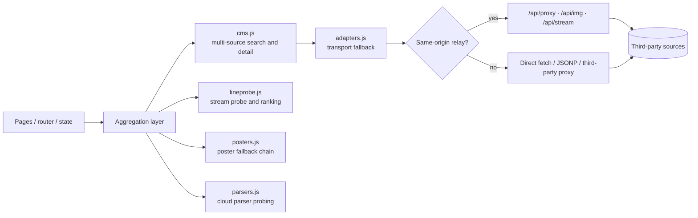

<div align="center">

<a href="https://ko-fi.com/creatememori">
  
</a>

# Zhiyinglu • Tv

> 🎬 A pure front-end media aggregator — parallel search across sources, click a poster and play

[](https://github.com/creatememori/zhiyinglu-tv/stargazers)
[](https://github.com/creatememori/zhiyinglu-tv/network/members)
[](https://github.com/creatememori/zhiyinglu-tv/issues)
[](./LICENSE)


[](https://ko-fi.com/creatememori)
[](https://qm.qq.com/q/tKu1lR8oPm)
[](https://ifdian.net/a/creatememori)


🖥️ **Live demo** → [tv-eosin-five.vercel.app](https://tv-eosin-five.vercel.app/)

<sub>⚠️ The demo runs on Vercel (overseas edge nodes). Some sources are rate-limited or blocked from outside mainland China, so lists and posters may load partially. Deploy it yourself for the full experience.</sub>

[](https://vercel.com/new/clone?repository-url=https://github.com/creatememori/zhiyinglu-tv)
[](https://dash.cloudflare.com/)

</div>

---

📖 **Readme:** **English** | [简体中文](README.zh.md)

> [!TIP]
> **In one line**: it merges a dozen video sites' search boxes into one page that runs entirely in your browser.
> No account, no database, no backend service. Broken sources back off on their own, slow streams get ranked down, and everything you watch stays in your IndexedDB.

> [!NOTE]
> Ships with **35 built-in CMS source endpoints** (21 enabled by default) · **8 directory references** · **9 cloud-parser sources**. Works out of the box, and every one of them can be replaced with your own.

## Table of Contents

- [What Problem It Solves](#what-problem-it-solves)
- [See It in 60 Seconds](#see-it-in-60-seconds)
- [Screenshots](#screenshots)
- [Features](#features)
- [How It Works](#how-it-works)
- [Data Sources](#data-sources)
- [Quick Start](#quick-start)
- [Deploy](#deploy)
- [Project Structure](#project-structure)
- [Tech Stack](#tech-stack)
- [Browser Support](#browser-support)
- [FAQ](#faq)
- [Privacy and Disclaimer](#privacy-and-disclaimer)
- [Support This Project](#support-this-project)
- [License](#license)

## What Problem It Solves

Finding one title usually means bouncing between several sites: this one has no results, that one has a dead stream, and the third makes you start over from the beginning. Zhiyinglu folds that into a single page and tries hard to keep **source quality** from ruining the experience.

| Typical aggregator | Zhiyinglu |
|---|---|
| Needs a backend, a database, a scraper | **Pure front-end** — the browser is the runtime; data lives in IndexedDB |
| One source dies, the page spins forever | Per-source health score, auto circuit-breaker for 2 hours, one-click health check |
| Search waits for every source to answer | 4 sources in parallel, **render as they arrive** |
| You only learn a stream is slow after clicking | Detail page pre-probes streams in the background and ranks them |
| You need a server before it runs | Vercel / Cloudflare Pages / any VPS; the relay is **optional** |

## See It in 60 Seconds

```bash
git clone https://github.com/creatememori/zhiyinglu-tv.git
cd zhiyinglu-tv
npm install
npm run dev        # → http://localhost:5173
```

Open the home page, search any title, click a poster — the streams are already there. A short onboarding modal appears on first run.

No local setup? Open the [live demo](https://tv-eosin-five.vercel.app/); the trade-off is that some mainland sources are unreachable from overseas nodes.

## Screenshots

| Home · hero | Home · rankings |
|---|---|
|  |  |
|  |  |

<details><summary><b>📱 Show the other 11 screenshots</b></summary>

| Home · mobile | Home · mobile |
|---|---|
|  |  |

| 🔍 Search | 📂 Category |
|---|---|
|  |  |

| 📂 Category · filters | ⚡ Cloud parser |
|---|---|
|  |  |

| 📖 Watch history | 📡 Sources |
|---|---|
|  |  |

| 🎨 Appearance | ⚙️ Settings |
|---|---|
|  |  |

| ⚙️ Settings · migration | |
|---|---|
|  | |

</details>

## Features

### 🏠 Home

- **Hero carousel** — trending titles, click straight into playback
- **Four categories** — movies / TV series / variety / anime
- **Rankings** — Douban ratings plus multi-genre boards, clicking sends it to in-app search
- **Today's updates** — live aggregation across enabled sources, deduped by title fingerprint
- **For you** — Douban picks mixed with source randomness, different every refresh

### 🔍 Parallel Search

- **4-way concurrency** — up to 4 sources at once, render the moment one answers
- **Fingerprint dedupe** — titles normalized (width, season suffixes, punctuation, traditional/simplified) and merged, tagged "2 sources / 3 sources"
- **Dual-protocol parsing** — JSON and XML auto-detected, field aliases mapped to one internal shape
- **Relevance filtering** — title similarity + year + keyword hits, so searching *Dune* doesn't return *Children of Dune*
- **Presets** — restrict the search scope to movies / series / anime / variety

### 🎬 Detail and Streams

- **Silent pre-probing** — the detail page probes each direct stream's first packet in the background, 6 in parallel, ~171–300 ms per line
- **Ranking** — source health × 0.4 + probe speed × 0.4 + direct-link bonus × 0.2
- **Same-CDN skip** — same hostname counts as the same failure domain, so a dead line doesn't cost a second attempt
- **Failure memory** — a stream that failed before is ranked down next time

### ▶️ Playback

- **ArtPlayer 5 + hls.js** — m3u8 / mp4 / flv; the player is a separate chunk (~400 KB) loaded only on the play page
- **Intro/outro skip** — remembered per title
- **Resume** — progress written to IndexedDB, survives refresh and config migration
- **Auto-next** — 3-second countdown to the next episode
- **Cloud parsing** — paste a VIP platform page URL and it routes through the parser sources
- **Live TV** — import an M3U source and play it in the live page (no seek bar, no speed control, not written to history)

### 📡 Sources and Relay

- **35 built-in CMS sources** (21 enabled) + **8 directory references** + **9 cloud parsers**
- **One-click health check** — 3-way parallel latency probe, health score, auto-disable of dead sources
- **Auto circuit-breaker** — a failing source is paused for 2 hours, then retried
- **Custom sources** — add an endpoint (`auto` / `xml` / `custom`) and import/export the whole config as JSON
- **Same-origin relay** — `/api/proxy`, `/api/img`, `/api/stream`; only allow-listed hosts are forwarded, images get a spoofed Referer

### 📱 PWA and Visuals

- **Offline app shell** — Service Worker caches static assets; navigation is network-first, assets are stale-while-revalidate
- **Installable** — add to home screen, near-native feel
- **Liquid glass** — a hand-written CSS design system (~78 KB) with 4 accent themes (aurora / vercel / sunset / mint)
- **Tunable** — glass intensity from 0 to 40, live preview
- **Motion details** — cursor glow, 3D wireframe, card tilt, scroll reveal, all respecting `prefers-reduced-motion`

## How It Works



### What happens on one search

1. **Pick sources** — only `enabled && searchable`, sorted by health score
2. **Run the pool** — 4 concurrent workers pull from the queue and **render first-arrival-first** (`onSourceResult` incremental callback)
3. **Transport** — each source starts with the method that worked last time; on failure it walks down the ladder below
4. **Parse** — JSON/XML auto-detected, fields like `vod_play_url` normalized to `[{name, eps:[{label,url}]}]`
5. **Dedupe** — normalized titles indexed and merged, keeping the richest record and tagging the number of sources
6. **Filter** — low-relevance results dropped
7. **Cache** — hits and fast streams cached for 30 minutes (max 60 entries), so a repeat search is instant

### Transport fallback ladder

Per source, per request, in order — the first success is remembered and used first next time.

| # | Method | When |
|---|---|---|
| 1 | Last known good method | Same source, same endpoint type |
| 2 | Same-origin relay `/api/proxy` | Deployed on Vercel / CF Pages / your own Worker |
| 3 | Direct `fetch` | The source sends CORS headers |
| 4 | JSONP | Legacy AppleCMS endpoints without CORS |
| 5 | Third-party proxies | Prefixes configured in settings, tried in order |

There is also a **race** between the relay and direct fetch: if the relay hasn't answered after 800 ms, the direct request starts too, and whichever lands first wins — no more "the relay is half a second slow, so the whole page waits".

### Poster fallback chain

Posters are the most fragile part (404s, hotlink protection, CORS), so there are three tiers:

1. **Original** — the source's own poster, if it loads
2. **Cross-source pool** — Douban `subject_suggest` → Bangumi → wmdb, matched by title **and** year to avoid false positives
3. **CDN mirror** — Douban's image host rejects hotlinks with 418, so it goes through the same-origin `/api/img` relay; bgm/wmdb fall back only after direct failure

Hits cache for 12 hours, misses for 1 hour (negative cache), and a gradient placeholder is used if everything fails — the page never blocks on a poster.

### Stream pre-probing

- Fetches only the **first 1 KB** via `Range`, ~171–300 ms per stream
- **6-way pool**: 15 streams finish in 2–3 seconds, hidden inside the time you spend reading the detail page
- Results cached in-session for **5 minutes**, reused by the play page
- A `text/html` response means "a page, not a stream" and is marked unplayable

### The relay (optional)

```
Browser ──▶ /api/proxy?url=<source>  ──▶ allowlist check ──▶ source
          /api/img?url=<image>       ──▶ Referer spoof + 1-day cache
          /api/stream?url=<segment>  ──▶ pass-through (m3u8 segments)
```

- Probes `/api/health` once per session, only on the same origin or a custom `relayBase`
- If a relay exists it is preferred (it sidesteps CORS), but **everything still works without one** — it degrades to direct fetch
- The allowlist lives in `worker/proxy-core.js`; `api/` and `functions/` share the same logic

## Data Sources

| Kind | Count | Purpose | Where |
|---|---|---|---|
| CMS sources | 35 (21 enabled) | Search, detail, streams | Sources → CMS |
| Directory references | 8 | Category indexes, no playback | Sources → Directory |
| Cloud parsers | 9 | Turn VIP page URLs into playable streams | Sources → Parser |

The 21 enabled sources are the ones verified to return data; the other 14 are directory sites, require authorization, or only return lists — disabled by default so they don't slow down health checks and search.

**Adding your own source** (Settings → Sources → Add):

```json
{
  "id": "my-cms",
  "name": "My Source",
  "api": "https://example.com/api.php/provide/vod",
  "format": "auto",
  "enabled": true,
  "searchable": true,
  "timeout": 9000
}
```

`format`: `auto` (detect JSON/XML), `xml` (fixed maccms XML), `custom` (non-standard shape, requires a direct-capable host).

**Import / export**: Settings → Data migration exports the whole config (sources, parsers, proxies, presets, playback preferences). Imports are strictly validated: http(s) URLs only, duplicate IDs rejected, and caps enforced (proxies 20 / presets 30 / live sources 200 / favorites 1000).

## Quick Start

**Requirements**: Node.js ≥ 18 (Vite 6 minimum), a modern browser.

```bash
npm install
npm run dev      # dev server at http://localhost:5173, local relay mounted
npm run build    # static output in dist/
npm run preview  # preview the build
npm test         # Node's native test runner, 14 test files
```

Notes:

- In dev, `vite.config.js` mounts `worker/proxy-core.js` as middleware, so `/api/*` works locally too
- The Service Worker is registered **in production builds only**, so it never interferes with HMR
- `start.sh` is a convenience wrapper for `dev-server.mjs` on a VPS (port 8787); it is optional

## Deploy

| Platform | Entry point | Notes |
|---|---|---|
| **Vercel** | `api/` | Auto-detected as a Serverless Function; overseas IPs may be limited by mainland sources |
| **Cloudflare Pages** | `functions/` | Auto-detected; you can also deploy `worker/` directly (`wrangler.toml` included) |
| **VPS / bare metal** | `node dev-server.mjs` | Port 8787, static + API in one process, best for mainland sources |

Deployment notes:

1. The output is plain static files — any static host works, and **it runs without a relay**, just with fewer CORS workarounds
2. To use the relay it must be same-origin with the site (or set `relayBase` in settings)
3. Source hostnames must be in the allowlist in `worker/proxy-core.js`, otherwise 403 — add the domain when you add a source
4. `api/proxy.js` on Vercel shares that allowlist; keep both sides in sync

## Project Structure

```text
.
├── api/                 # Vercel Serverless: proxy / img / stream / health
├── functions/           # Cloudflare Pages Functions: thin wrappers
├── worker/              # Cloudflare Worker; proxy-core.js is the single implementation
├── src/
│   ├── api/             # Aggregation engine: cms / adapters / lineprobe / posters / parsers
│   ├── core/            # State, router, IndexedDB, config migration, utils
│   ├── pages/           # home / search / category / detail / play / history / sources / settings / live
│   ├── player/          # ArtPlayer wrapper + custom progress bar
│   ├── ui/              # Toast / modal / poster cards / SVG icon set
│   ├── effects/         # Cursor glow / 3D wireframe / card tilt / scroll reveal
│   └── styles/          # Liquid-glass design system
├── public/              # logo, manifest, Service Worker
├── tests/               # 14 native Node test files
├── docs/screenshots/    # README screenshots
├── dev-server.mjs       # all-in-one VPS server (static + API)
├── vite.config.js       # relative base, player chunk, local relay plugin
└── vercel.json / wrangler.toml / start.sh
```

## Tech Stack

| Category | Technology | Notes |
|---|---|---|
| Framework | **Vanilla ES Modules** | No React / Vue / jQuery; pages mount per route |
| Build | Vite 6 | `base: './'`, deployable under any sub-path |
| Player | ArtPlayer 5 · hls.js | Separate chunk, loaded on the play page |
| Storage | IndexedDB | Progress, history, favorites, config, poster cache |
| PWA | Service Worker · Web Manifest | Offline app shell + SWR for static assets |
| Relay | Workers / Pages Functions / Vercel | One `proxy-core.js`, three hosts |
| Tests | Node.js native test runner | No Jest / Vitest needed |

There are exactly two runtime dependencies: `artplayer` and `hls.js`. Everything else is hand-written.

## Browser Support

| Browser | Support | Notes |
|---|---|---|
| Chrome / Edge 90+ | ✅ | Full experience, PWA installable |
| Safari 15+ (incl. iOS) | ✅ | Use Share → Add to Home Screen for a standalone window |
| Firefox 90+ | ✅ | No PWA install entry; everything else works |
| Legacy browsers | ⚠️ | Requires ES Modules / IndexedDB / Service Worker; IE is unsupported |

On mobile, add it to the home screen: with the address bar gone it feels close to a native app.

## FAQ

<details>
<summary><b>Why does a source return nothing, or fail to play?</b></summary>

Three usual reasons: the source is down, it blocks overseas IPs, or it validates Referer.

Run Sources → Health check first; failing sources are auto-disabled for 2 hours. If search works but playback doesn't, the stream itself is likely dead — pick another line or another source. Deployments on overseas nodes will fail much more often against mainland sources.
</details>

<details>
<summary><b>Most sources broke after deploying to Vercel — is that a bug?</b></summary>

No. Vercel egresses from overseas IPs, and many mainland media APIs refuse or return empty for those. For stability, deploy the same repo to a mainland VPS (`node dev-server.mjs`), or point `relayBase` in settings at your own relay.
</details>

<details>
<summary><b>Is it really backend-free? What is the relay for?</b></summary>

The application logic is 100% in the browser: search, parsing, dedupe, playback and storage never touch a server. The relay does one thing — issue the request on your behalf so the browser's CORS rules don't block it. Without a relay the app falls back to direct fetch / JSONP; it still works, just with fewer reachable sources.
</details>

<details>
<summary><b>Where is my data stored? Will I lose it on a new device?</b></summary>

In the browser's IndexedDB (progress, history, favorites, config, poster cache). Clearing site data deletes it. To move devices, export JSON from Settings → Data migration and import it on the other side.
</details>

<details>
<summary><b>How do I install the PWA?</b></summary>

- Android / desktop Chrome / Edge: click the install icon in the address bar
- iOS Safari: Share → Add to Home Screen
- Once installed it opens without browser chrome; offline it still shows the app shell (content needs network)
</details>

<details>
<summary><b>I updated but still see the old UI.</b></summary>

The Service Worker caches the app shell. Force a reload (Ctrl/Cmd + Shift + R) or close all tabs and reopen. Each release bumps `VERSION` in `sw.js`, which clears old caches automatically.
</details>

<details>
<summary><b>How do I add my own source?</b></summary>

Settings → Sources → Add, enter the name and API URL, and leave `format` on `auto` (JSON/XML auto-detected). Use `custom` for non-standard shapes that must be reachable directly. Run Health check to confirm, then enable it. For bulk changes, use Data migration → import JSON.

If you run your own relay, add the new hostname to the allowlist in `worker/proxy-core.js`.
</details>

<details>
<summary><b>Posters are slow or blank.</b></summary>

Posters use a three-tier chain (original → Douban/Bangumi/wmdb → CDN mirror). Douban's image host answers 418 without the right Referer, so `/api/img` is required; without a relay some posters fail and a gradient placeholder is shown instead of a broken image. Successful lookups are cached for 12 hours.
</details>

<details>
<summary><b>Does it support casting, downloading, or speed control?</b></summary>

- Speed: yes (player built-in)
- Casting: no — there is no stable cross-browser protocol; use OS-level mirroring
- Downloading: no, and it is not planned — playback only, no video is ever written to disk
</details>

<details>
<summary><b>Why are so many built-in sources disabled?</b></summary>

Of the 35, 21 are enabled. The other 14 are directory sites, require authorization, or only return lists without playable streams. Keeping them off avoids slowing down health checks and search; enable them from the sources page when you need them.
</details>

## Privacy and Disclaimer

- **No video content is stored or uploaded.** The app only aggregates metadata and playback URLs returned by third-party public APIs
- Playback URLs come from third-party sites and their availability/legality is their responsibility. This project does not host, transcode, or cache video streams (`/api/stream` is a pure pass-through)
- All personal data (progress, history, favorites, config) stays in your browser; the author cannot access it
- Sources are collected from public networks. If you are a rights holder and believe a source infringes, contact that source directly; this project will remove the default entry upon notice
- For learning and technical research only. Follow the laws of your jurisdiction

## Support This Project

If it saved you from bouncing between tabs:

- ⭐ A **Star** is the simplest encouragement
- ☕ [Buy the author a coffee](https://ko-fi.com/creatememori)
- 💜 [Afdian](https://ifdian.net/a/creatememori)
- 💬 QQ group: [661816585](https://qm.qq.com/q/tKu1lR8oPm) (bug reports, dead-source updates)

[](https://star-history.com/#creatememori/zhiyinglu-tv&Date)

## License

[MIT](./LICENSE) © 2026 creatememori

---

<div align="center">

<a href="https://ko-fi.com/creatememori"></a>

<sub>💬 QQ group: 661816585 · This app stores and uploads no video content; it only aggregates third-party public APIs.</sub>

</div>