<div align="center">

<a href="https://ko-fi.com/creatememori">
  
</a>

# Zhiyinglu · Tv

### One search box. Many film archives. A projection room in your browser.

**A pure front-end media aggregator with a cinema-grade interface — no account, no database, no server required.**

[](https://github.com/creatememori/zhiyinglu-tv/stargazers)
[](https://github.com/creatememori/zhiyinglu-tv/network/members)
[](https://github.com/creatememori/zhiyinglu-tv/issues)
[](./LICENSE)


[](https://ko-fi.com/creatememori)
[](https://qm.qq.com/q/tKu1lR8oPm)
[](https://ifdian.net/a/creatememori)


🖥️ **Live demo** → [tv-eosin-five.vercel.app](https://tv-eosin-five.vercel.app/)

<sub>⚠️ The public demo runs on overseas edge nodes. Some mainland sources are rate-limited or blocked there, so lists and posters may load partially. Deploy it yourself for the full experience.</sub>

[](https://vercel.com/new/clone?repository-url=https://github.com/creatememori/zhiyinglu-tv)
[](https://dash.cloudflare.com/)

</div>

---

📖 **Readme:** **English** · [简体中文](README.zh-CN.md)

> [!TIP]
> **The short version** — Zhiyinglu turns a dozen AppleCMS-compatible video sites into one searchable library. Search fans out across sources and renders results as they arrive. Pick a poster, and it probes the available lines, ranks them, and opens a player that remembers where you stopped.
>
> Everything runs in the browser. Your history, favourites, settings, and playback progress live in IndexedDB — not on someone else's server.

> [!NOTE]
> **v1.0.0 — The Projection Room.** A full-bleed cinema hero, a 3D filmstrip of what's hot, film grain and timecode, an official liquid-glass Dock with a draggable refracting thumb, tactile click/hold/loading feedback, and a parser health manifest that keeps trying sources instead of giving up on the first failure.

## Table of Contents

- [Why This Exists](#why-this-exists)
- [What You Get](#what-you-get)
- [A 60-Second Tour](#a-60-second-tour)
- [Screenshots](#screenshots)
- [Features](#features)
- [How It Works](#how-it-works)
- [Quick Start](#quick-start)
- [Deploy](#deploy)
- [Project Structure](#project-structure)
- [Tech Stack](#tech-stack)
- [Browser Support](#browser-support)
- [FAQ](#faq)
- [Privacy and Disclaimer](#privacy-and-disclaimer)
- [Support](#support)
- [License](#license)

## Why This Exists

Finding one film usually means opening five tabs: one site has the title but no working stream, another has a dead player, and the third loses your progress when you refresh.

Zhiyinglu is an attempt to make that feel like one place — and to make the interface feel like a cinema rather than a database.

It is deliberately **not** a streaming service. It is a browser-side aggregation layer over public third-party APIs, wrapped in an interface built around posters, light, and motion.

| The usual aggregator | Zhiyinglu |
|---|---|
| Backend, database, scraper to maintain | Pure front-end; IndexedDB is the persistence layer |
| One source dies and the page spins | Per-source health, circuit breaker, and an auto-touring parser pool |
| Search waits for the slowest source | 4 concurrent workers, results rendered as they arrive |
| You discover a dead line after clicking | Detail page probes stream lines in the background and ranks them |
| A generic dashboard UI | Projection-room styling: film grain, timecode, serif titles, a liquid-glass Dock |

## What You Get

| | |
|---|---|
| **35** built-in CMS sources | **21** enabled by default, all replaceable |
| **8** directory references | Browsing indexes, no playback |
| **9** cloud parser sources | Health-checked, auto-touring fallback |
| **4-way** parallel search | Incremental rendering, title fingerprint dedupe |
| **6-way** stream probing | First 1 KB via `Range`, ranked by health, speed, and directness |
| **3** runtime dependencies | `artplayer`, `hls.js`, `@colineapp/liquid-glass` |

## A 60-Second Tour

1. **Search once.** Type a title. Four sources are queried at once; cards appear as each source answers. Duplicate titles are merged and tagged with how many sources returned them.
2. **Open a poster.** The detail page pulls every playable line across sources and probes them quietly in the background.
3. **Press play.** ArtPlayer handles HLS/MP4/FLV. Your progress, intro/outro skips, and favourites are stored locally.
4. **When a source fails, keep going.** The parser panel probes all configured parsers, marks each one available / unverified / unavailable, and tours the best candidates until one loads.
5. **Come back later.** The same state is there — including the last episode and the exact second.

## Screenshots

| Home · hero | Home · filmstrip |
|---|---|
| 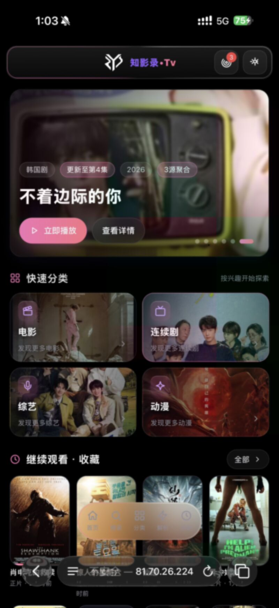 | 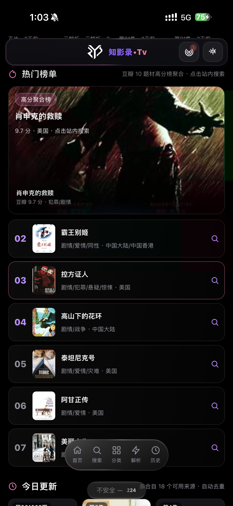 |
| 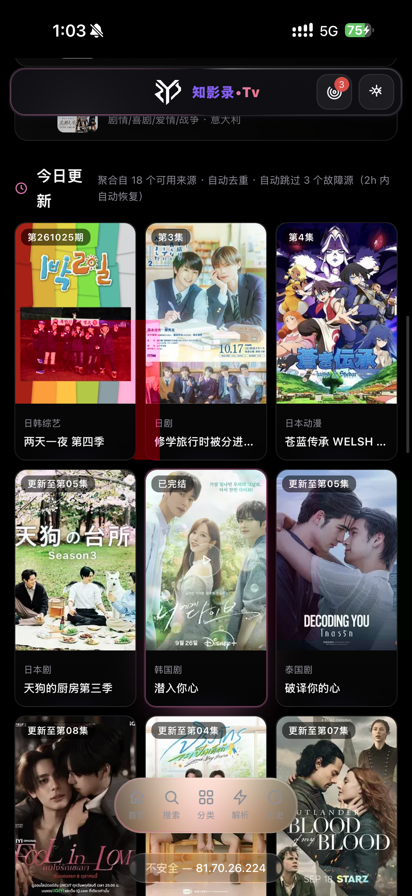 | 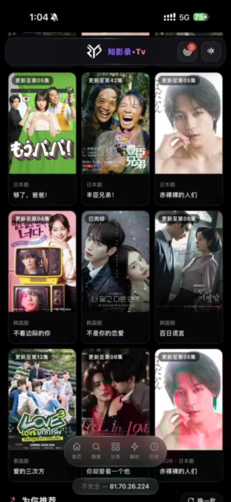 |

<details><summary><b>📱 Show the other 11 screenshots</b></summary>

| Home · mobile | Home · mobile |
|---|---|
| 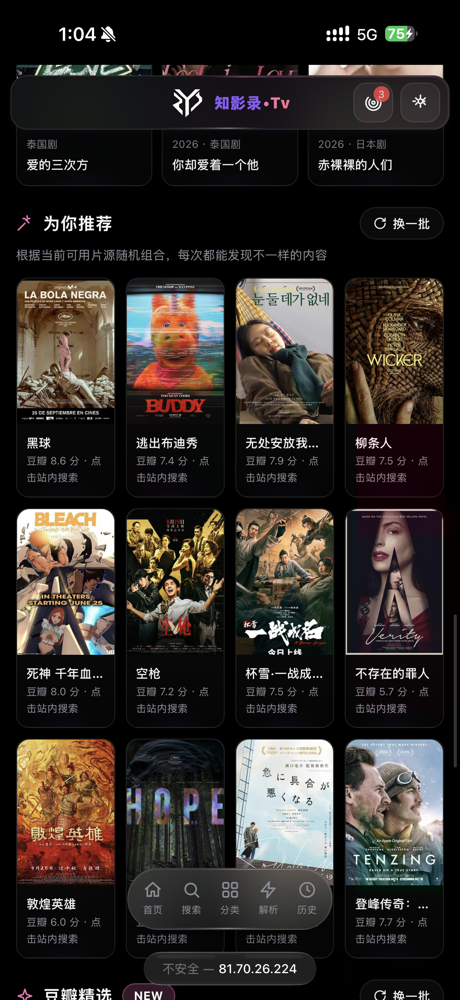 | 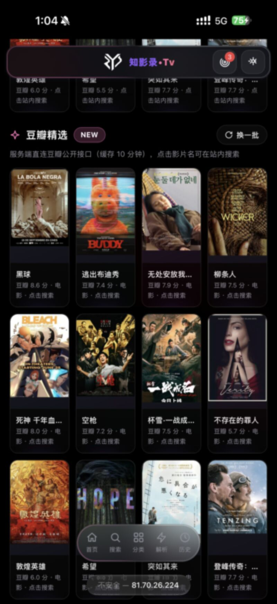 |

| 🔍 Search | 📂 Category |
|---|---|
| 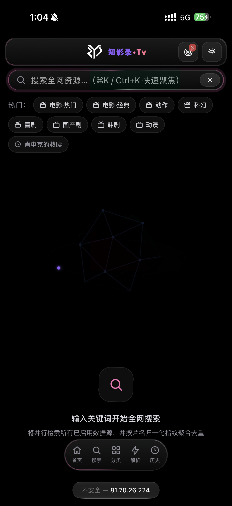 | 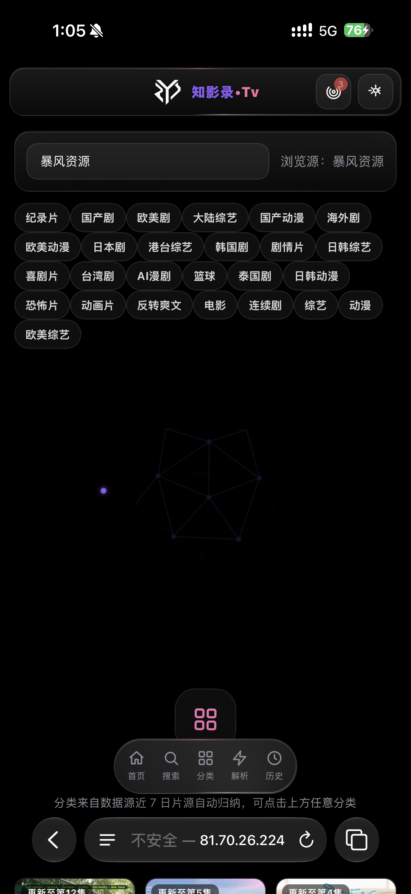 |

| 📂 Category · filters | ⚡ Cloud parser |
|---|---|
| 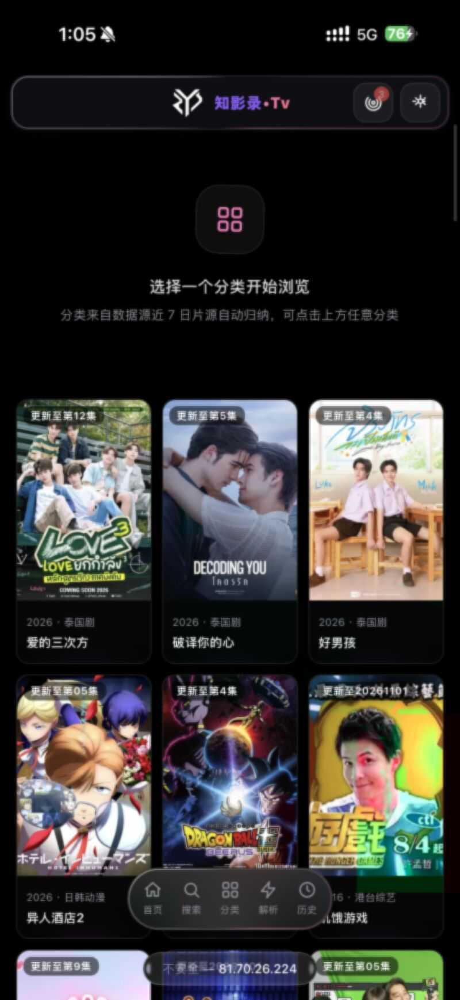 | 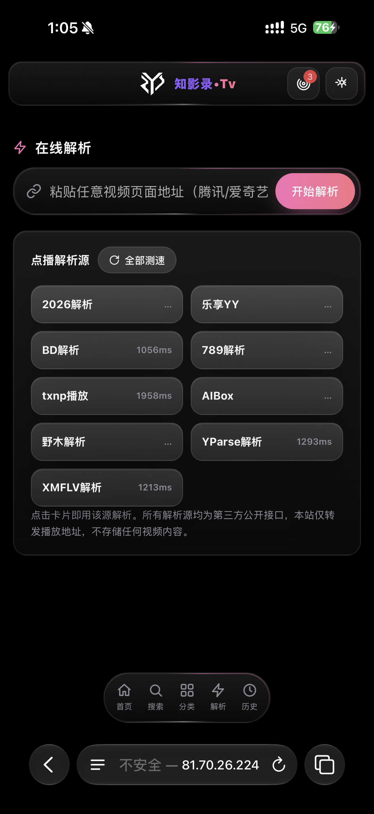 |

| 📖 Watch history | 📡 Sources |
|---|---|
| 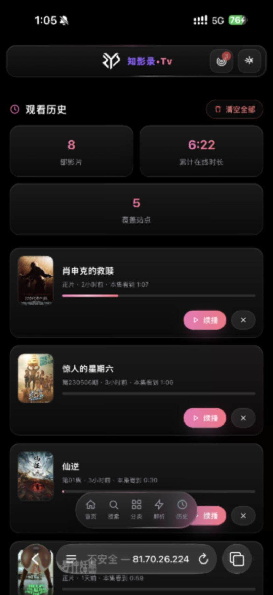 | 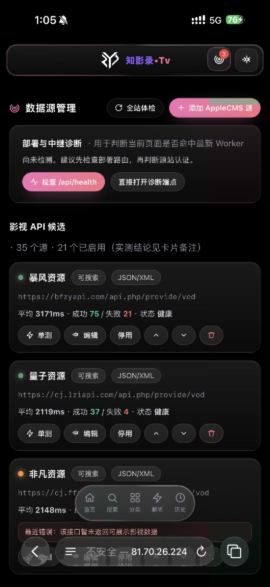 |

| 🎨 Appearance | ⚙️ Settings |
|---|---|
| 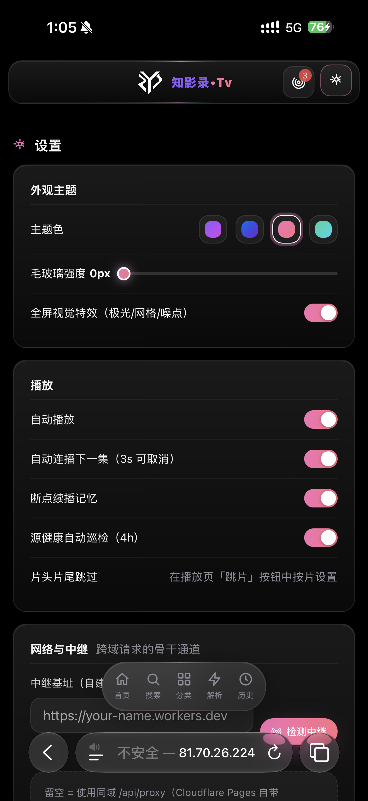 | 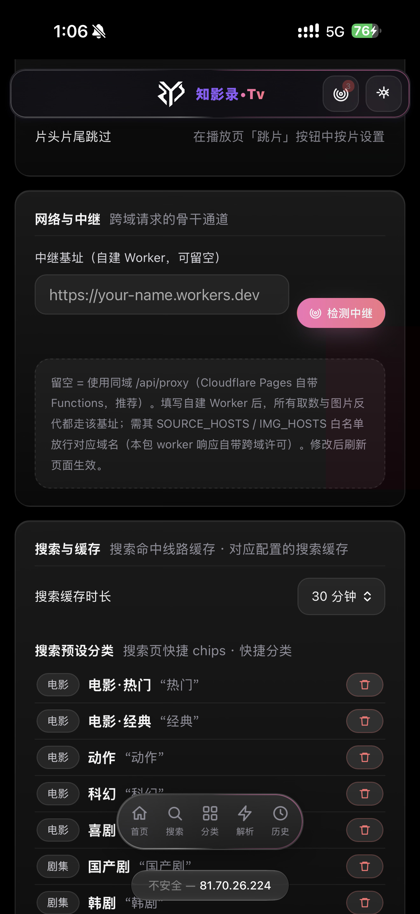 |

| ⚙️ Settings · migration | |
|---|---|
| 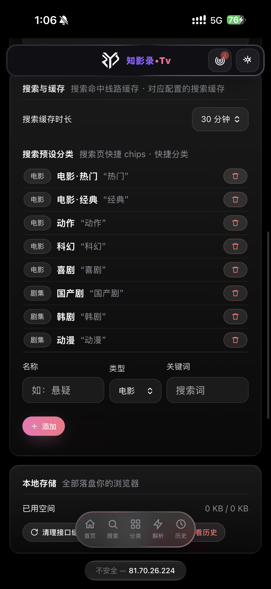 | |

</details>

## Features

### 🎬 The Projection Room

The interface is built around a simple idea: a film site should feel like a screening room, not a SaaS dashboard.

- **Full-bleed hero** — Ken Burns drift, a projector beam, film perforations, vertical reel marks, and frame thumbnails instead of dots.
- **3D filmstrip** — the "now showing" rail uses perspective and centre-distance transforms; drag it, use the arrows, or tab to it.
- **Scene headers** — every section reads like a shot list (`SCENE 01`), with serif titles and monospaced metadata.
- **Film texture** — a low-frame-rate canvas grain layer, a running timecode, a scroll progress line, and a `FIN` credit roll.
- **Liquid-glass Dock** — the official `@colineapp/liquid-glass` tab track. The selected thumb lifts into a lens, bends the labels as it is dragged, and refills when it lands.
- **Tactile feedback** — click sparks, press swell, a hold-to-charge ring, and a lattice loading indicator for parser hand-offs.
- **Respectful motion** — every new effect honours `prefers-reduced-motion` and the app's "reduce effects" setting.

### 🔍 Parallel Search

- **4 concurrent workers** — results render source by source, not after the slowest one.
- **Fingerprint dedupe** — width, punctuation, season suffixes, and traditional/simplified variants are normalised before merging.
- **Dual protocol** — JSON and XML AppleCMS responses are auto-detected and mapped to one shape.
- **Relevance filter** — title similarity, year, and keyword hits; searching *Dune* does not fill the page with *Children of Dune*.
- **Presets** — narrow the pool to movies, series, anime, or variety.

### 🎞️ Detail and Streams

- **Silent pre-probing** — each stream line is probed with a 1 KB `Range` request, six at a time.
- **Ranking** — source health, probe latency, and direct-link preference decide the order.
- **Same-CDN skip** — one dead host does not cost a second attempt on the same CDN.
- **Failure memory** — lines that failed before are ranked down next time.
- **Resume everything** — episode, position, and intro/outro skips are remembered per title.

### ▶️ Playback

- **ArtPlayer 5 + hls.js** — HLS, MP4, and FLV; the player is a separate chunk loaded only on the play page.
- **Cloud parsing that keeps trying** — nine parser sources, a build-time health manifest, four-state chips, and automatic touring. Dead sources are skipped; unverified ones are not declared dead.
- **Live TV** — import an M3U playlist; live channels are played without history or seek state.
- **Keyboard and touch** — custom progress bar, episode grid, and a desktop layout that wraps the progress bar onto its own row instead of squeezing the video.

### 📡 Sources and Relay

- **35 CMS sources** (21 enabled), **8 directory references**, **9 cloud parsers**.
- **Health checks** — three-way latency probes, health scores, and automatic circuit breaking.
- **Custom sources** — add an endpoint with `auto` / `xml` / `custom` parsing, or import/export the whole configuration as JSON.
- **Optional relay** — `/api/proxy`, `/api/img`, `/api/stream`; allow-listed hosts only, Referer spoofing for posters, and a pass-through for HLS segments.

### 📱 PWA and Data

- **Installable** — offline app shell, network-first navigation, stale-while-revalidate assets.
- **Local-first** — history, favourites, config, progress, and poster cache live in IndexedDB.
- **Portable** — export/import the whole configuration; nothing is tied to an account.
- **Bilingual UI** — Chinese and English, with a first-run language choice.

## How It Works

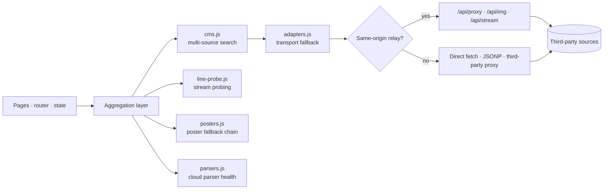

### One search, step by step

1. **Select sources** — only enabled and searchable entries, ordered by health.
2. **Run the pool** — four workers pull from the queue; each result triggers an incremental render callback.
3. **Transport** — start with the method that worked last time; on failure, walk the fallback ladder.
4. **Parse** — JSON/XML auto-detection and normalisation into one episode shape.
5. **Merge** — normalised titles are indexed, duplicates merged, source count recorded.
6. **Filter and cache** — low-relevance results are dropped; hits and fast streams are cached for 30 minutes.

### Poster fallback chain

1. **Original** — the source's own poster.
2. **Cross-source pool** — Douban `subject_suggest` → Bangumi → wmdb, matched by title and year.
3. **CDN mirror** — the same-origin `/api/img` relay when Douban rejects hotlinks.

Hits are cached for 12 hours, misses for 1 hour, and a gradient placeholder is used when everything fails.

### Parser touring

The parser panel does not stop at the first source:

1. A build-time manifest (`public/jx-health.json`, refresh with `npm run health`) records each parser's last known state.
2. The client ranks candidates by state, target-specific memory, and speed.
3. It loads the best direct candidate, then automatically tours the remaining ones on timeout or error.
4. A parser that loads a page but shows a parse error can be advanced manually with **Next line**.
5. If all candidates fail, the panel offers **open in a new window**, **change target**, or **switch source** instead of a dead end.

## Quick Start

**Requirements:** Node.js ≥ 18 and a modern browser.

```bash
git clone https://github.com/creatememori/zhiyinglu-tv.git
cd zhiyinglu-tv
pnpm install        # or: npm install
pnpm run dev        # Vite dev server at http://localhost:5173
```

```bash
pnpm run build      # static output in dist/
pnpm run preview    # preview the build
pnpm test           # Node's native test runner (15 files, 86 tests)
pnpm run health     # optional: refresh the parser health manifest
```

Notes:

- `vite.config.js` mounts `worker/proxy-core.js` as middleware in dev, so `/api/*` works locally.
- The Service Worker is registered in production builds only, so it never interferes with HMR.
- `node dev-server.mjs` serves static files and the API in one process on port 8787; `start.sh` wraps it for a VPS.

## Deploy

| Platform | Entry point | Notes |
|---|---|---|
| **Vercel** | `api/` | Auto-detected serverless function; overseas egress may be blocked by mainland sources |
| **Cloudflare Pages** | `functions/` | Auto-detected; `worker/` can also be deployed directly with `wrangler.toml` |
| **VPS / bare metal** | `node dev-server.mjs` | Port 8787, static + API in one process; best for mainland sources |
| **Any static host** | `dist/` | Works without a relay, with fewer CORS workarounds |

Deployment notes:

1. The build output is plain static files.
2. A relay must be same-origin with the site, or set `relayBase` in Settings.
3. New source hostnames must be added to the allowlist in `worker/proxy-core.js`.
4. `api/proxy.js` and the Worker share the same allowlist; keep them in sync.

## Project Structure

```text
.
├── api/                 # Vercel Serverless: proxy / img / stream / health
├── functions/           # Cloudflare Pages Functions: thin wrappers
├── worker/              # Cloudflare Worker; proxy-core.js is the single relay implementation
├── src/
│   ├── api/             # Aggregation: cms / adapters / line-probe / posters / parsers / resolver
│   ├── core/            # State, router, IndexedDB, config migration, utilities
│   ├── pages/           # home / search / category / detail / play / history / sources / settings / live
│   ├── player/          # ArtPlayer wrapper + custom progress bar
│   ├── ui/              # Toast / modal / poster cards / SVG icon set
│   ├── effects/         # cinema, liquid-dock, feedback, interactions, wireframe
│   └── styles/          # app.css + cinema.css + feedback.css
├── public/              # logo, manifest, Service Worker, parser health manifest
├── scripts/             # jx-health.mjs (build-time parser probe)
├── tests/               # 15 native Node test files
├── docs/                # screenshots, design notes, relay contract
├── dev-server.mjs       # all-in-one VPS server (static + API)
├── vite.config.js       # relative base, player chunk, local relay plugin
└── vercel.json / wrangler.toml / start.sh
```

## Tech Stack

| Category | Technology | Notes |
|---|---|---|
| Framework | **Vanilla ES Modules** | No React / Vue / jQuery; each route mounts its own page |
| Build | Vite 6 | Relative `base`, deployable under any sub-path |
| Player | ArtPlayer 5 · hls.js | Separate chunk, loaded only on the play page |
| Glass | `@colineapp/liquid-glass` 0.3 | Official tab track and refracting thumb |
| Storage | IndexedDB | Progress, history, favourites, config, poster cache |
| PWA | Service Worker · Web Manifest | Offline shell + stale-while-revalidate |
| Relay | Workers · Pages Functions · Vercel | One `proxy-core.js`, three hosts |
| Tests | Node.js native test runner | No Jest or Vitest |

Three runtime dependencies: `artplayer`, `hls.js`, and `@colineapp/liquid-glass`. Everything else is hand-written.

## Browser Support

| Browser | Support | Notes |
|---|---|---|
| Chrome / Edge 90+ | ✅ | Full experience, PWA installable |
| Safari 15+ (iOS included) | ✅ | Add to Home Screen for a standalone window |
| Firefox 90+ | ✅ | No PWA install entry; everything else works |
| Legacy browsers | ⚠️ | Requires ES Modules, IndexedDB, and Service Worker; IE is unsupported |

> The liquid-glass Dock uses SVG refraction. Chromium gets real edge bending; Safari and Firefox fall back to frosted glass with a rim light. The effect also degrades on low-memory devices and when reduced motion is enabled.

## FAQ

<details>
<summary><b>Why does a source return nothing, or fail to play?</b></summary>

Usually one of three things: the source is down, it blocks overseas IPs, or it validates Referer. Run **Sources → Health check** first; failing sources are paused for two hours. If search works but playback does not, the stream line itself is likely dead — try another line or another source.
</details>

<details>
<summary><b>Most sources broke after deploying to Vercel — is that a bug?</b></summary>

No. Vercel egresses from overseas IPs, and many mainland media APIs refuse those requests. For stability, deploy to a mainland VPS with `node dev-server.mjs`, or point `relayBase` at your own relay.
</details>

<details>
<summary><b>Is it really backend-free?</b></summary>

The application logic is entirely in the browser: search, parsing, dedupe, playback, and storage never touch a server. The relay only exists to get around CORS for sources that require it. Without a relay, the app falls back to direct fetch / JSONP.
</details>

<details>
<summary><b>Where is my data stored?</b></summary>

In IndexedDB: progress, history, favourites, config, and poster cache. Clearing site data deletes it. Export JSON from **Settings → Data migration** to move devices.
</details>

<details>
<summary><b>I updated, but still see the old UI.</b></summary>

The Service Worker caches the app shell. Force a reload (Ctrl/Cmd + Shift + R) or close all tabs and reopen. Each release bumps `VERSION` in `public/sw.js` and clears old caches.
</details>

<details>
<summary><b>How do I add a source?</b></summary>

Open **Settings → Sources → Add**, enter a name and API URL, and leave `format` on `auto` (JSON/XML detected). Use `custom` for non-standard shapes that are reachable directly. Run a health check, then enable it. For bulk changes, import JSON from **Data migration**.
</details>

<details>
<summary><b>Why are some built-in sources disabled?</b></summary>

Of the 35, 21 are enabled. The rest are directory sites, require authorisation, or return lists without playable streams. Keeping them off makes health checks and search faster.
</details>

## Privacy and Disclaimer

- **No video content is stored or uploaded.** The app aggregates metadata and playback URLs returned by third-party public APIs.
- Playback URLs belong to third-party sites; their availability and legality are their responsibility. This project does not host, transcode, or cache video streams (`/api/stream` is a pass-through).
- All personal data stays in your browser. The author cannot access it.
- Sources are collected from public networks. If you are a rights holder and believe a source infringes, contact that source directly; the default entry will be removed upon notice.
- For learning and technical research only. Follow the laws of your jurisdiction.

## Support

- ⭐ Star the repository — the simplest encouragement.
- ☕ [Buy the author a coffee](https://ko-fi.com/creatememori)
- 💜 [Afdian](https://ifdian.net/a/creatememori)
- 💬 QQ group: [661816585](https://qm.qq.com/q/tKu1lR8oPm) — bug reports and dead-source updates.

[](https://star-history.com/#creatememori/zhiyinglu-tv&Date)

## License

[MIT](./LICENSE) © 2026 creatememori

---

<div align="center">

<a href="https://ko-fi.com/creatememori"></a>

<sub>💬 QQ group 661816585 · No video content is hosted. Only third-party public APIs are aggregated.</sub>

</div>