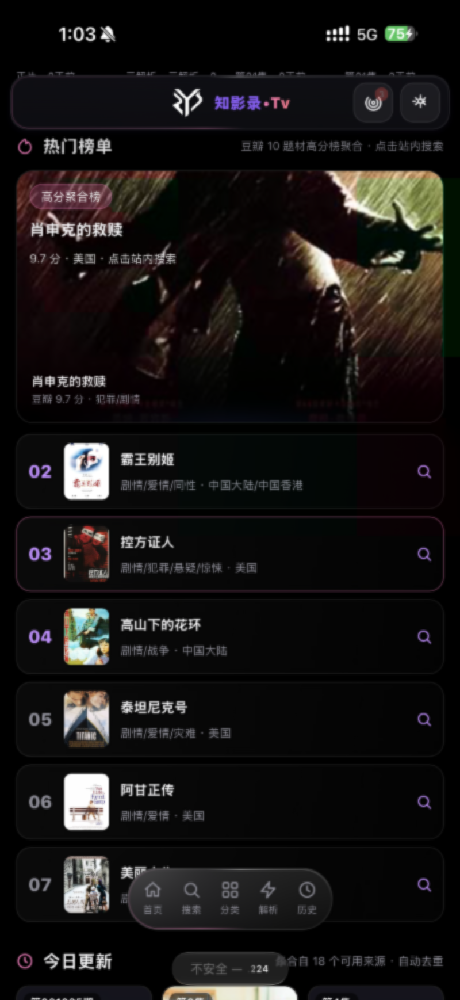
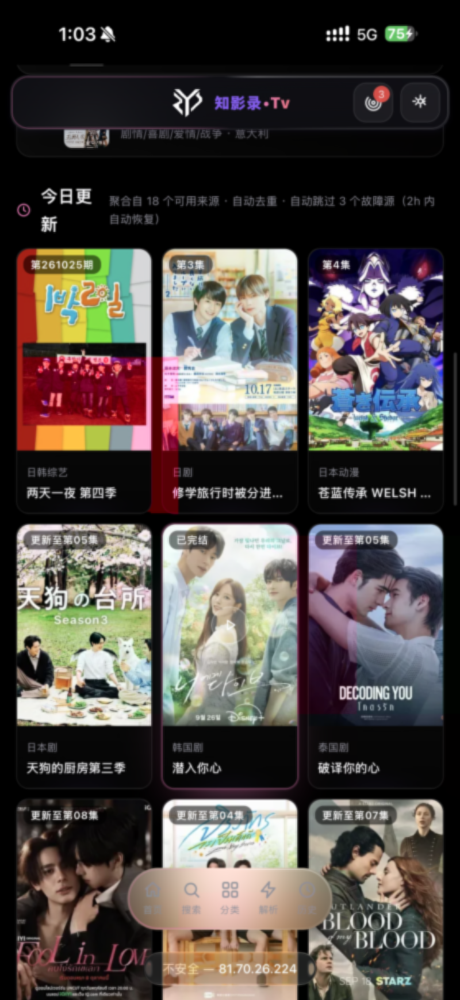
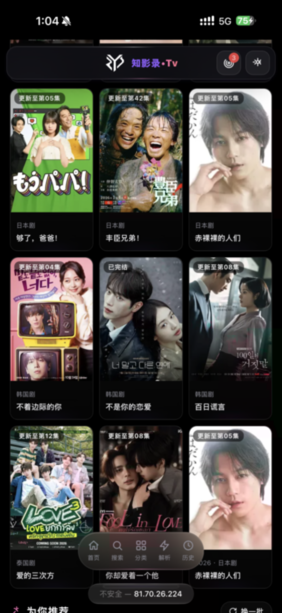

<div align="center">

<a href="https://ko-fi.com/creatememori">
  
</a>

# 知影录 • Tv

> 🎬 纯前端影视聚合 SPA — 多源并行搜索，命中即播

[](https://github.com/creatememori/zhiyinglu-tv/stargazers)
[](https://github.com/creatememori/zhiyinglu-tv/network/members)
[](https://github.com/creatememori/zhiyinglu-tv/issues)


[](https://ko-fi.com/creatememori)
[](https://qm.qq.com/q/creatememori)

[](https://vercel.com/new/clone?repository-url=https://github.com/creatememori/zhiyinglu-tv)
[](https://dash.cloudflare.com/)

</div>

---

⚡ **开箱即用** · 内置 14 个 API 源，无需手动导入  
🎬 **聚合搜索** · 全源并行 + 指纹去重 + 逐源增量渲染  
📺 **流畅播放** · ArtPlayer 5 + hls.js · 片头尾跳过 · 自定义进度条  
🎨 **暗色毛玻璃** · 紫色渐变主题 · 四种主题色 · 响应式适配  
📱 **PWA 离线壳** · 可安装到主屏 · 离线缓存

## 📸 界面预览

<table align="center">
  <tr>
    <td align="center"><b>🏠 首页聚合</b></td>
    <td align="center"><b>🔍 全源搜索</b></td>
  </tr>
  <tr>
    <td></td>
    <td></td>
  </tr>
</table>

<details>
<summary>📱 更多界面截图</summary>

<table align="center">
  <tr>
    <td align="center"><b>📂 分类浏览</b></td>
    <td align="center"><b>🎬 播放页面</b></td>
  </tr>
  <tr>
    <td></td>
    <td></td>
  </tr>
  <tr>
    <td align="center"><b>📡 数据源管理</b></td>
    <td align="center"><b>⚙️ 设置页面</b></td>
  </tr>
  <tr>
    <td></td>
    <td></td>
  </tr>
  <tr>
    <td align="center"><b>📖 影片详情</b></td>
    <td align="center"><b>📺 电视直播</b></td>
  </tr>
  <tr>
    <td></td>
    <td></td>
  </tr>
</table>

</details>

## ✨ 功能特性

### 🏠 首页聚合

- **Hero 轮播** · 热门影片大图展示，一键播放
- **快速分类** · 电影 / 连续剧 / 综艺 / 动漫 四大入口
- **热门榜单** · 豆瓣高分榜 + 多题材聚合，点击站内搜索
- **今日更新** · 17 个可用来源聚合去重，实时更新
- **为你推荐** · 豆瓣精选 + 源站随机，每次不一样

### 🔍 全源并行搜索

- **最多 4 源并发** · 片名指纹去重 · 命中即得线路
- **逐源增量渲染** · 先到的先展示，越搜越多
- **搜索预设分类** · 一键切换电影 / 剧集 / 动漫

### 🎬 播放体验

- **ArtPlayer 5** · hls.js 驱动，支持 m3u8/mp4/flv
- **自定义进度条** · 点击跳转 · 拖拽滑块 · 悬浮时间预览 · 缓冲显示
- **片头片尾跳过** · 按片名记忆 intro/outro 秒数
- **断点续播** · IndexedDB 持久化，刷新不丢进度
- **自动连播** · 剧集结束自动跳下一集
- **云解析** · VIP 平台页面地址自动走解析源

### 📡 数据源

- **14 个内置 API 源** · 12 个实测可用 + 2 个半可用
- **一键体检** · 并行探测延迟 + 健康评分排序
- **自定义源** · 支持手动添加 / 导入配置

### 📱 PWA 支持

- **离线应用壳** · Service Worker 缓存静态资源
- **可安装** · 添加到主屏，接近原生体验
- **本地存储** · 设置 / 历史 / 进度全部落盘浏览器

## 🚀 快速开始

```bash
git clone https://github.com/creatememori/zhiyinglu-tv.git
cd zhiyinglu-tv
npm install
npm run dev        # 本地开发 → http://localhost:5173
npm run build      # 生产构建 → dist/
npm test           # 运行测试 (14 项)
```

## ☁️ 平台托管部署

| 平台 | 说明 | 操作 |
|------|------|------|
| **Vercel** | `api/` 自动识别 Functions | [](https://vercel.com/new/clone?repository-url=https://github.com/creatememori/zhiyinglu-tv) |
| **Cloudflare Pages** | `functions/` 自动接管 API | 连接仓库 → `npm run build` → `dist/` |
| **VPS / 裸机** | Node.js 16+ | `node dev-server.mjs` → `:8787` |

## ⚙️ 配置说明

### 环境变量

| 变量 | 说明 | 默认值 |
|------|------|--------|
| `PORT` | 服务端口 | `8787` |
| `SOURCE_HOSTS` | 额外数据源域名 | — |
| `IMG_HOSTS` | 额外图片域名 | — |

### 配置文件结构

```
src/
├── api/       # 聚合引擎 · 解析器 · 封面链 · 线路探测
├── core/      # state / router / db(IndexedDB) / config / utils
├── pages/     # home / search / category / detail / play / live
├── player/    # ArtPlayer 封装 + video-bar 自定义进度条
├── ui/        # Toast / Modal / 海报卡片 / SVG 图标集
├── effects/   # 光标光晕 / 3D 线框 / 滚动渐入
└── styles/    # 液态毛玻璃设计系统 (78KB CSS)
```

## 🛠️ 技术栈

| 类别 | 技术 |
|------|------|
| 框架 | **原生 ES Module** · 零框架依赖 |
| 构建 | Vite 6 |
| 播放器 | ArtPlayer 5 · hls.js |
| 存储 | IndexedDB |
| PWA | Service Worker · Web Manifest |
| 中继 | Cloudflare Workers / Pages Functions / Vercel Serverless |
| 测试 | Node.js Native Test Runner |

## 📄 License

MIT © 2026

---

<div align="center">
  <a href="https://ko-fi.com/creatememori">
    
  </a>
  <br>
  <sub>💬 QQ群：661816585</sub>
  <br><br>
  <sub>本应用不存储、不上传任何视频内容，仅聚合第三方公开接口</sub>
</div>