<div align="center">

<a href="https://ko-fi.com/creatememori">
  
</a>

# 知影录 • Tv

> 🎬 纯前端影视聚合 SPA — 多源并行搜索，命中即播

[](https://github.com/creatememori/zhiyinglu-tv/stargazers)
[](https://github.com/creatememori/zhiyinglu-tv/network/members)
[](https://github.com/creatememori/zhiyinglu-tv/issues)


[](https://ko-fi.com/creatememori)
[](https://qm.qq.com/q/creatememori)

[](https://vercel.com/new/clone?repository-url=https://github.com/creatememori/zhiyinglu-tv)
[](https://dash.cloudflare.com/)

</div>

<style>
  blockquote, .markdown-body blockquote { border-left: 3px solid #8b5cf6 !important; }
</style>


---

📖 **Readme:** [简体中文](README.md) | [English](README.en.md)

> 🦾 <span style="color:#8b5cf6">**纯前端架构**</span> — 不依赖 React / Vue / jQuery，原生 ES Module 自主驱动，**无后端，浏览器即引擎**

> ⚡ <span style="color:#d946ef">**多源并行引擎**</span> — 14 源并发聚合 · 格式探测 → 双协议解析 → 字段归一 · **先到先显，逐源增量渲染**

> 🎯 <span style="color:#8b5cf6">**命中即播**</span> — 搜索命中直接出播放线路，无需中转详情页，域名级 CDN 同源故障自动跳过

> 🖥️ <span style="color:#d946ef">**服务端级中继**</span> — 同域 API 代理解决 CORS 封锁 · Worker singleflight 请求合并 · Cloudflare / Vercel 双平台兼容

> 🧠 <span style="color:#8b5cf6">**智能封面链**</span> — 原图 → 跨源海报池 → CDN 镜像 · 豆瓣 / Bangumi / wmdb 三路兜底 · 并行竞速 + 看门狗出图

> 📦 <span style="color:#d946ef">**全栈浏览器化**</span> — IndexedDB 持久化全部数据 · PWA 离线壳 + SWR 缓存 · **零服务器，打开即用**

## 📸 界面预览

### 🏠 首页

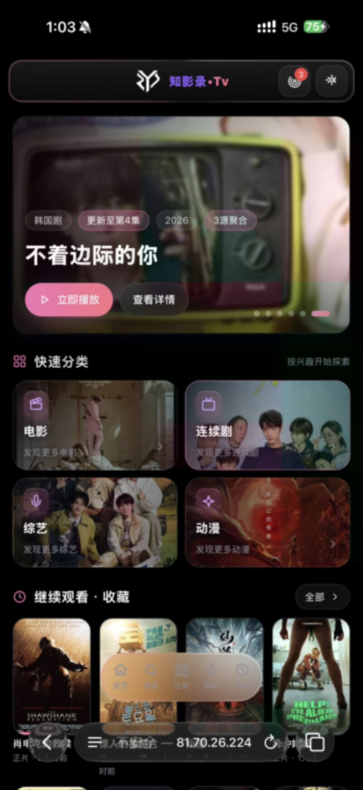 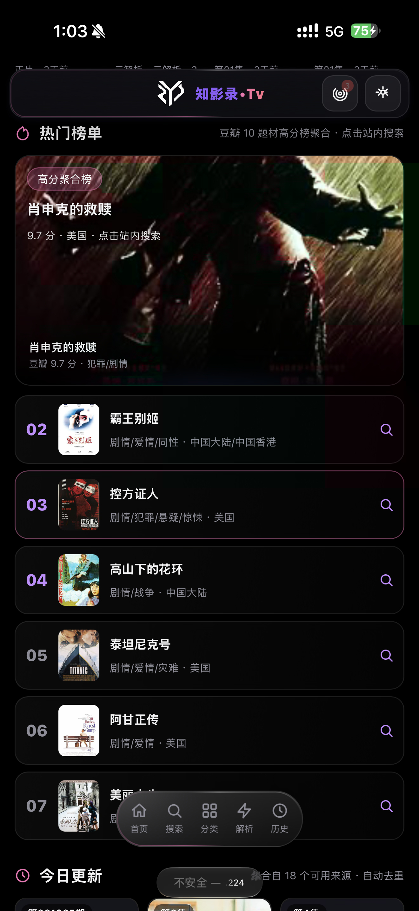 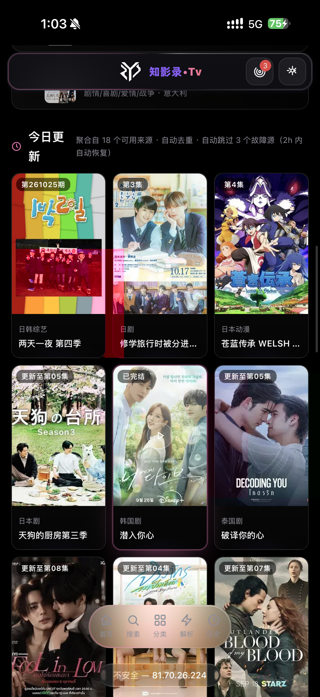

<details>
<summary>📱 首页更多截图</summary>
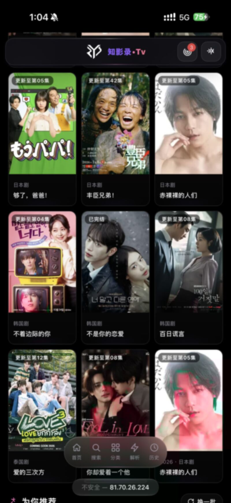 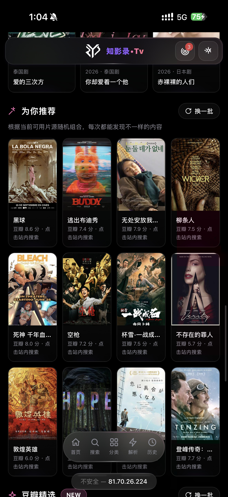 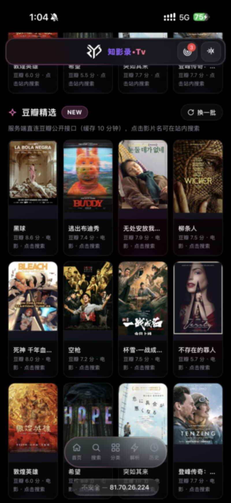
</details>

### 🔍 搜索

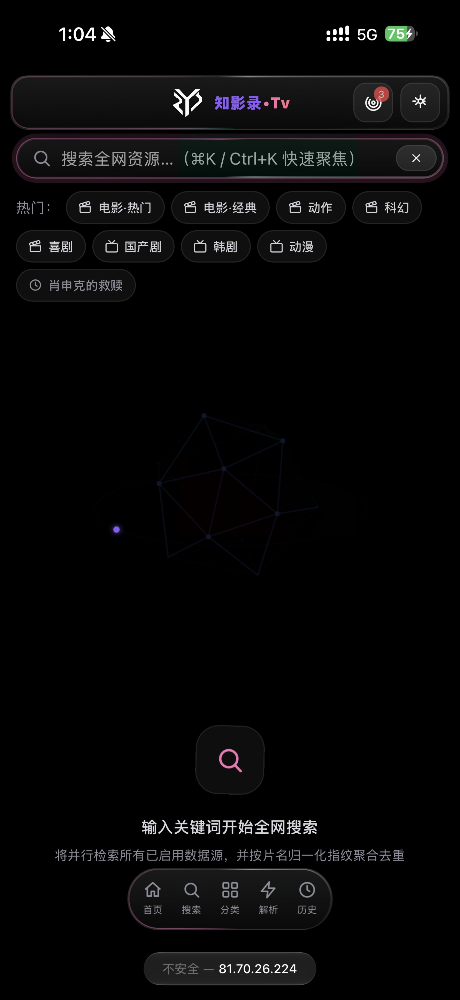

### 📂 分类

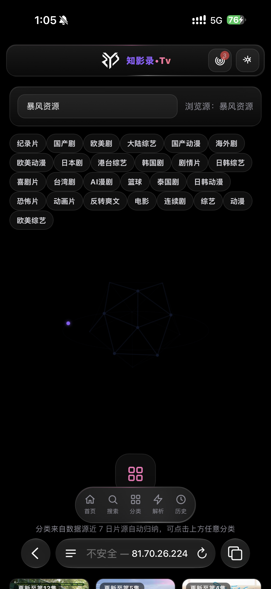 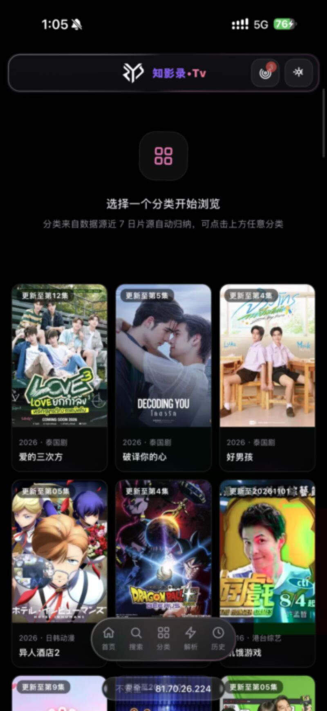

### ⚡ 在线解析

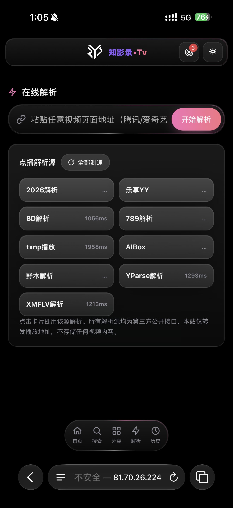

### 📖 观看历史

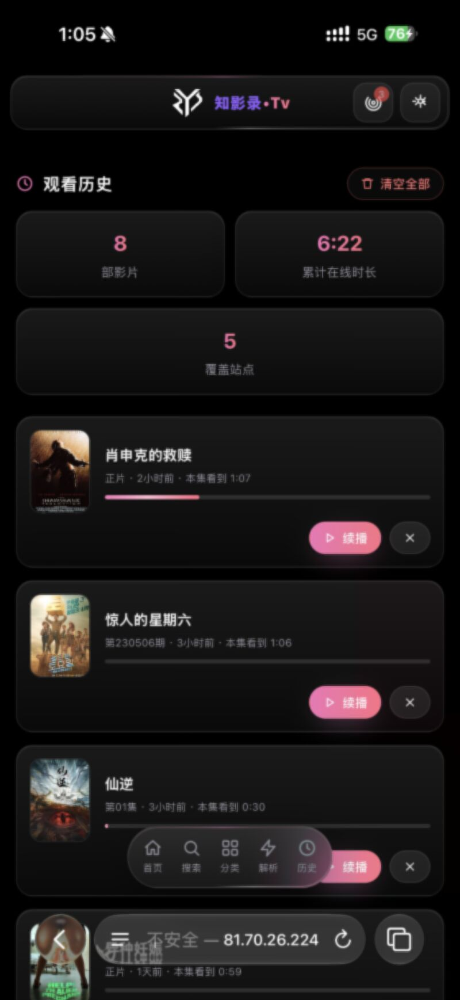

### 📡 数据源管理

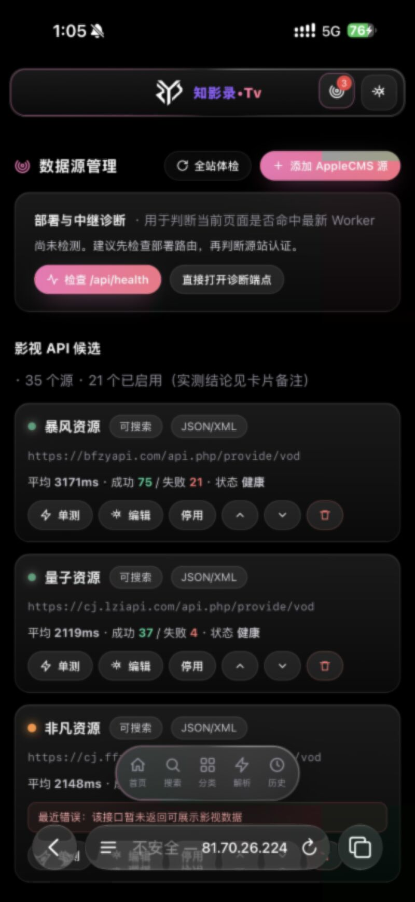

### 🎨 UI 自定义

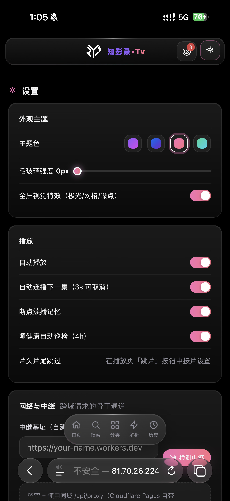

### ⚙️ 设置

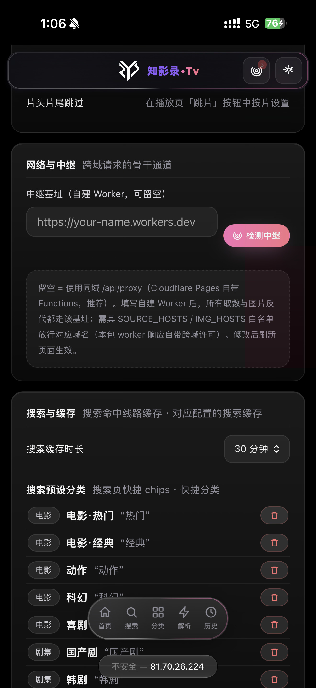 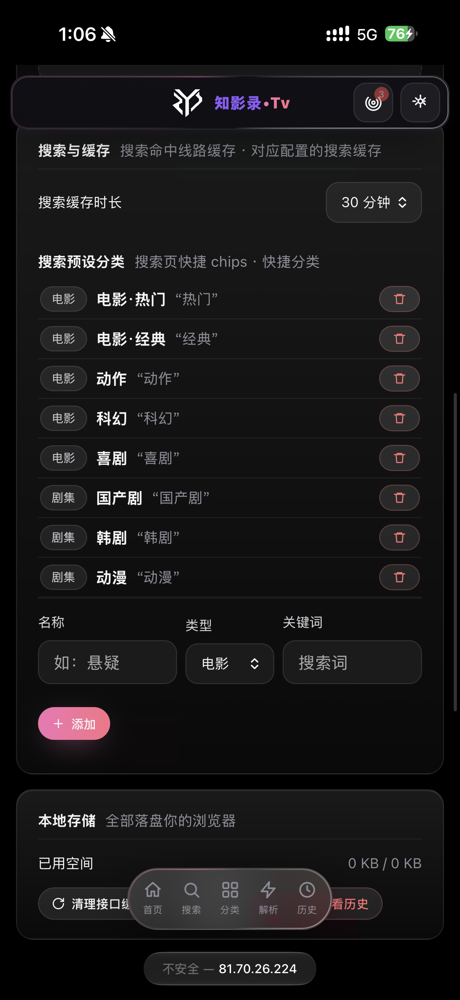

## ✨ 功能特性

### 🏠 首页聚合推荐

- **Hero 轮播** · 热门影片大图展示，一键跳转播放
- **快速分类入口** · 电影 / 连续剧 / 综艺 / 动漫四大版块
- **热门榜单** · 豆瓣高分 + 多题材聚合，点击站内搜索
- **今日更新** · 17+ 数据源聚合去重，实时刷新
- **为你推荐** · 个性化推荐 + 豆瓣精选

### 🔍 全源并行搜索

- 最多 4 源并发，片名指纹去重，命中即得线路
- 逐源增量渲染 — 先到的先展示，越搜越多
- 搜索预设分类，一键切换电影/剧集/动漫

### 🎬 播放体验

- **ArtPlayer 5** · hls.js 驱动，m3u8/mp4/flv 全支持
- **自定义紫色进度条** · 点击跳转 · 拖拽滑块 · 悬浮时间预览
- **片头片尾跳过** · 按片名独立记忆
- **断点续播** · IndexedDB 持久化
- **自动连播** · 剧集结束自动跳下一集

### 📡 数据源

- 14 个内置 API 源，一键体检并行探测
- 健康评分排序，自动停用失效源
- 支持自定义源 + 配置导入导出

### 📱 PWA 离线壳

Service Worker 缓存静态资源，可安装到桌面

## 🚀 快速开始

```bash
git clone https://github.com/creatememori/zhiyinglu-tv.git
cd zhiyinglu-tv
npm install
npm run dev         # 本地 → http://localhost:5173
npm run build       # 生产 → dist/
npm test            # 运行测试
```

## ☁️ 平台托管部署

| 平台 | 说明 |
|------|------|
| **Vercel** | `api/` 自动识别 Serverless Functions |
| **Cloudflare Pages** | `functions/` 自动接管 API 中继 |
| **VPS / 裸机** | `node dev-server.mjs` → 端口 8787 |

[](https://vercel.com/new/clone?repository-url=https://github.com/creatememori/zhiyinglu-tv)

## ⚙️ 配置文件结构

```
src/
├── api/          # 聚合引擎 · 解析器 · 封面降级链 · 线路预检
├── core/         # 状态管理 · 路由 · IndexedDB · 配置迁移
├── pages/        # 首页 · 搜索 · 分类 · 详情 · 播放 · 直播 · 设置
├── player/       # ArtPlayer 封装 + video-bar 自定义进度条
├── ui/           # Toast · Modal · 海报卡片 · SVG 图标集
├── effects/      # 光标光晕 · 3D 线框 · 卡片倾斜 · 滚动渐入
└── styles/       # 液态毛玻璃设计系统 (78KB CSS)
```

## 🛠️ 技术栈

| 类别 | 技术 |
|------|------|
| 框架 | **原生 ES Module** · 零运行时依赖 |
| 构建 | Vite 6 |
| 播放器 | ArtPlayer 5 · hls.js |
| 存储 | IndexedDB |
| PWA | Service Worker · Web Manifest |
| 中继 | Cloudflare Workers / Pages Functions / Vercel Serverless |
| 测试 | Node.js Native Test Runner |

## 📄 License

MIT © 2026

---

<div align="center">
  <a href="https://ko-fi.com/creatememori"></a>
  <br><sub>💬 QQ群：661816585</sub>
  <br><br>
  <sub>本应用不存储、不上传任何视频内容，仅聚合第三方公开接口</sub>
</div>