<div align="center">

<a href="https://ko-fi.com/creatememori">
  
</a>

# 知影录 · Tv

### 一个搜索框，装下许多片库；一座开在浏览器里的放映室。

**纯前端影视聚合站，影院级界面。无账号、无数据库、无需服务器即可运行。**

[](https://github.com/creatememori/zhiyinglu-tv/stargazers)
[](https://github.com/creatememori/zhiyinglu-tv/network/members)
[](https://github.com/creatememori/zhiyinglu-tv/issues)
[](./LICENSE)


[](https://ko-fi.com/creatememori)
[](https://qm.qq.com/q/tKu1lR8oPm)
[](https://ifdian.net/a/creatememori)


🖥️ **在线演示** → [tv-eosin-five.vercel.app](https://tv-eosin-five.vercel.app/)

<sub>⚠️ 公共演示部署在 Vercel 海外节点。部分大陆源会被限流或直接拒绝，片单与海报可能只加载一部分。想要完整体验，请自行部署。</sub>

[](https://vercel.com/new/clone?repository-url=https://github.com/creatememori/zhiyinglu-tv)
[](https://dash.cloudflare.com/)

</div>

---

📖 **说明文档：** [English](README.md) · **简体中文**

> [!TIP]
> **一句话** —— 知影录把十几个 AppleCMS 兼容站点合成一个搜索框。搜索会并发请求多个源，谁先返回就先渲染；点开海报后，它会在后台探测各条线路、排序、打开播放器，并记住你看到第几秒。
>
> 所有逻辑都在浏览器里。历史、收藏、设置、播放进度都存在 IndexedDB，而不是别人的服务器上。

> [!NOTE]
> **v1.0.0 · 放映室。** 全幅影院 Hero、3D 胶片廊、胶片颗粒与时间码、官方液态玻璃 Dock（可拖动的折射 thumb）、点击/长按/加载触感反馈，以及一套“失败也会继续尝试”的解析源健康清单。

## 目录

- [为什么做这个](#为什么做这个)
- [你会得到什么](#你会得到什么)
- [60 秒体验](#60-秒体验)
- [截图](#截图)
- [功能](#功能)
- [工作原理](#工作原理)
- [快速开始](#快速开始)
- [部署](#部署)
- [项目结构](#项目结构)
- [技术栈](#技术栈)
- [浏览器支持](#浏览器支持)
- [常见问题](#常见问题)
- [隐私与免责声明](#隐私与免责声明)
- [支持项目](#支持项目)
- [许可证](#许可证)

## 为什么做这个

想找一部片，通常要开五个标签页：这个站有片名却没有能播的线路，那个站播放器挂了，第三个站一刷新就丢了进度。

知影录想把这件事收进一个页面里，并且让界面更像一间放映室，而不是一张数据表。

它刻意**不是**一个影视站：它是浏览器端的聚合层，数据来自第三方公开 API，界面围绕海报、光、运动来设计。

| 常见聚合站 | 知影录 |
|---|---|
| 需要后端、数据库、爬虫维护 | 纯前端；IndexedDB 就是持久层 |
| 一个源挂掉，页面一直转圈 | 源健康分、熔断、解析源自动巡游 |
| 搜索要等最慢的源 | 4 路并发，谁先到谁先渲染 |
| 点进去才发现线路是死的 | 详情页后台探测线路并排序 |
| 通用后台式 UI | 放映室视觉：胶片颗粒、时间码、宋体标题、液态玻璃 Dock |

## 你会得到什么

| | |
|---|---|
| **35** 个内置 CMS 源 | 默认启用 **21** 个，全部可替换 |
| **8** 个导航站参考 | 用于分类索引，不直接播放 |
| **9** 个云解析源 | 带健康清单，自动巡游 |
| **4 路**并发搜索 | 增量渲染，标题指纹去重 |
| **6 路**线路探测 | `Range` 只取前 1 KB，按健康分/速度/直连排序 |
| **3** 个运行时依赖 | `artplayer`、`hls.js`、`@colineapp/liquid-glass` |

## 60 秒体验

1. **搜一次。** 输入片名，四个源同时请求；每返回一个源就渲染一批卡片。重复片名会合并，并标注“2 源 / 3 源”。
2. **点开海报。** 详情页汇总所有可播线路，在后台静默探测。
3. **点播放。** ArtPlayer 负责 HLS / MP4 / FLV；进度、片头片尾跳过、收藏都存在本地。
4. **源挂了就继续。** 解析面板会并发体检所有解析源，标出“可用 / 未验证 / 不可用”，并自动巡游最佳候选，直到一条加载成功。
5. **下次回来。** 上次看到第几集、第几秒，还在。

## 截图

| 首页 · Hero | 首页 · 胶片廊 |
|---|---|
| 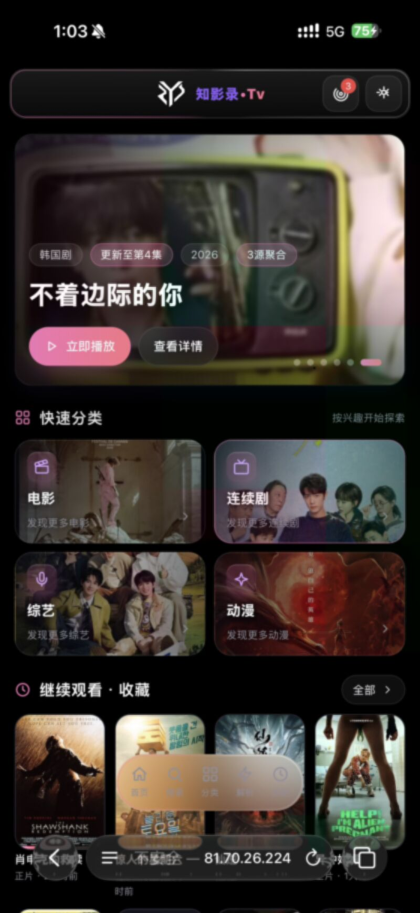 | 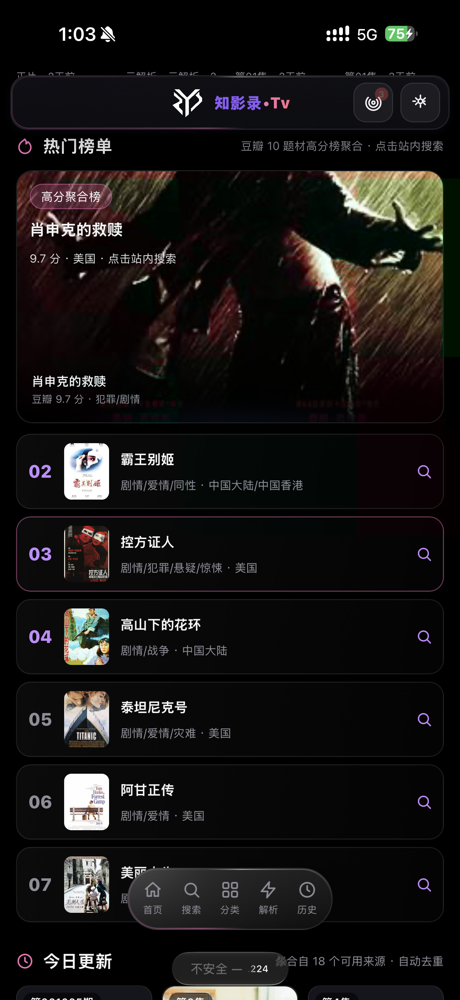 |
| 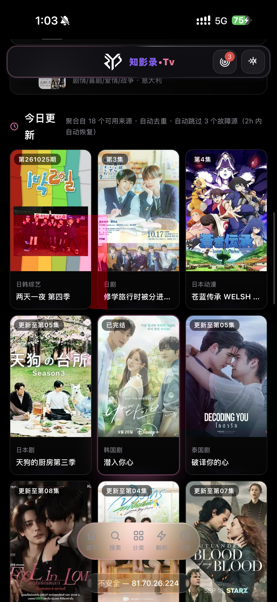 | 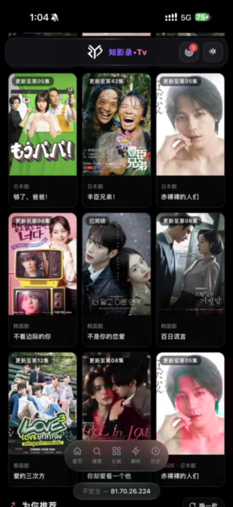 |

<details><summary><b>📱 展开其余 11 张截图</b></summary>

| 首页 · 手机 | 首页 · 手机 |
|---|---|
| 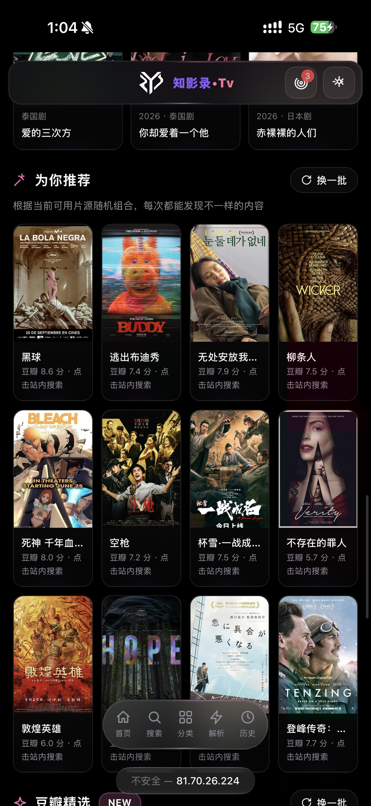 | 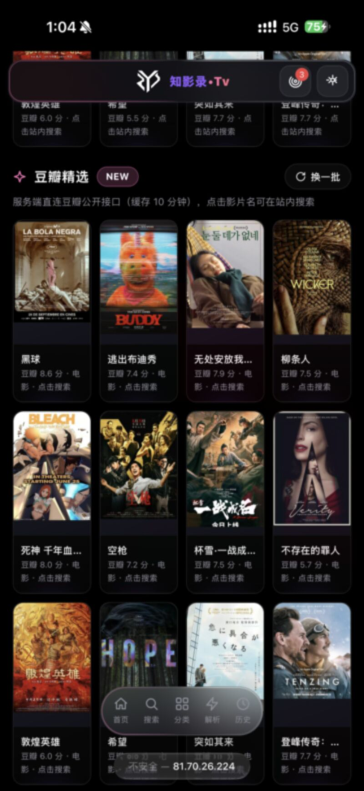 |

| 🔍 搜索 | 📂 分类 |
|---|---|
| 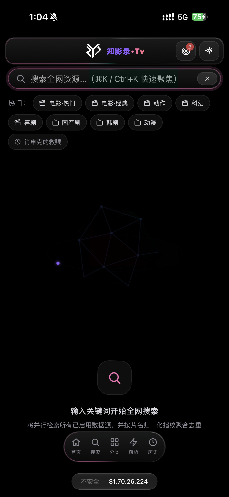 | 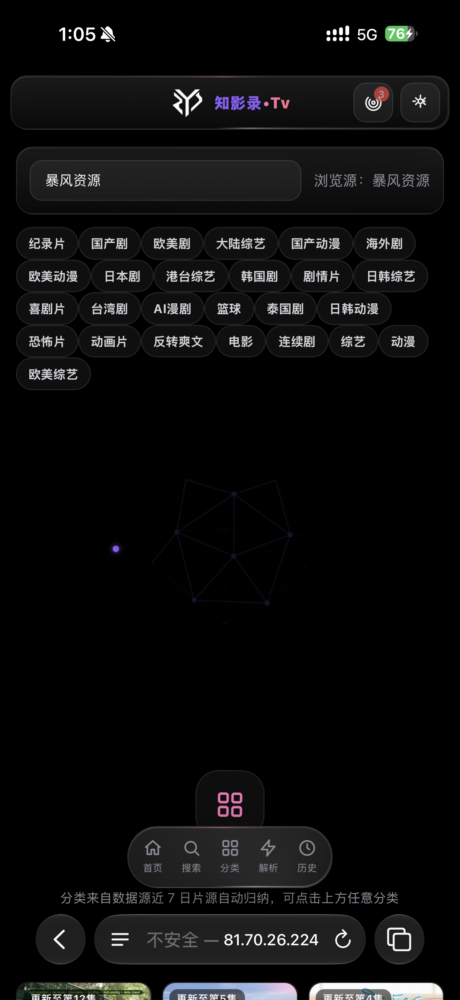 |

| 📂 分类 · 筛选 | ⚡ 云解析 |
|---|---|
| 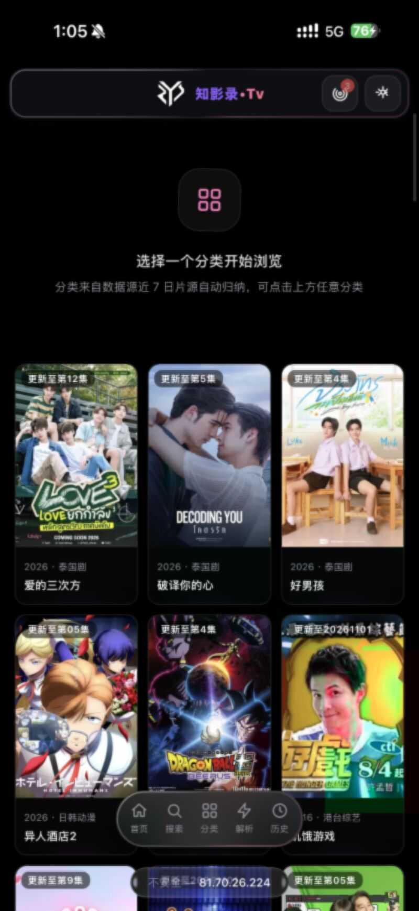 | 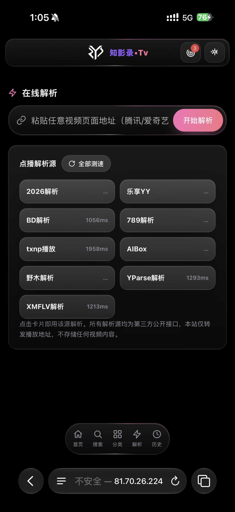 |

| 📖 观看历史 | 📡 数据源 |
|---|---|
| 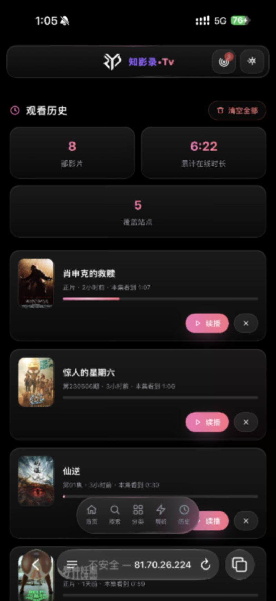 | 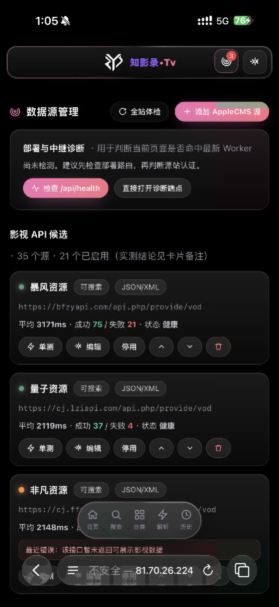 |

| 🎨 外观 | ⚙️ 设置 |
|---|---|
| 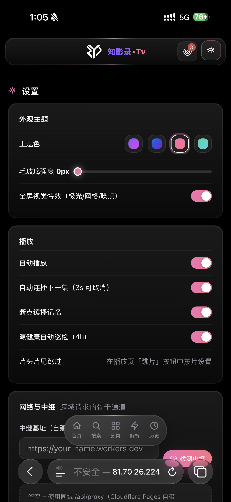 | 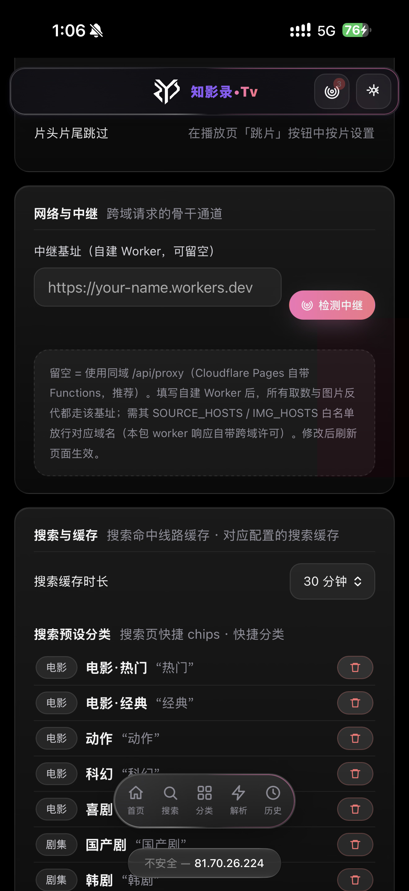 |

| ⚙️ 设置 · 迁移 | |
|---|---|
| 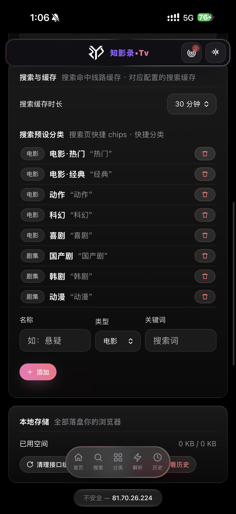 | |

</details>

## 功能

### 🎬 放映室

界面只围绕一件事：影视站应该像一间放映厅，而不是 SaaS 后台。

- **全幅 Hero** —— Ken Burns 缓慢推近、放映机光扫、胶片齿孔、左侧 REEL 场记、右侧帧缩略图。
- **3D 胶片廊** —— “正在热映”横向轨道按卡片中心距离计算透视、旋转与缩放；可拖拽、箭头、键盘。
- **场记标题** —— 每个区块像镜头清单（`SCENE 01`），宋体标题配等宽元信息。
- **胶片质感** —— 低帧率 Canvas 颗粒、运行时间码、滚动进度线、片尾 `FIN` 字幕。
- **液态玻璃 Dock** —— 官方 `@colineapp/liquid-glass` tab 轨道；选中的 thumb 会抬成镜片，拖动时拉伸并折射标签，落位后回填。
- **触感反馈** —— 点击火花、按压回弹、长按充能环、解析接力时的 lattice 加载。
- **尊重动态偏好** —— 所有新效果都遵守 `prefers-reduced-motion` 与“减少特效”设置。

### 🔍 并发搜索

- **4 路并发** —— 结果按源到达顺序渲染，不等待最慢的源。
- **指纹去重** —— 先统一全半角、标点、季数后缀、简繁，再合并。
- **双协议** —— JSON 与 XML AppleCMS 响应自动识别，映射成同一结构。
- **相关性过滤** —— 标题相似度、年份、关键词共同判断；搜《沙丘》不会满屏《沙丘之子》。
- **预设** —— 可限定电影 / 剧集 / 动漫 / 综艺。

### 🎞️ 详情与线路

- **静默预探测** —— 每条线路用 `Range` 只取前 1 KB，6 路并发。
- **排序** —— 源健康分、探测延迟、是否直连共同决定顺序。
- **同 CDN 跳过** —— 同一个死域名不会浪费第二次尝试。
- **失败记忆** —— 失败过的线路下次自动降权。
- **续播** —— 集数、秒数、片头片尾跳过都按片名记住。

### ▶️ 播放

- **ArtPlayer 5 + hls.js** —— 支持 HLS、MP4、FLV；播放器单独分包，只在播放页加载。
- **会继续尝试的云解析** —— 9 个解析源、构建期健康清单、四态标记、自动巡游。死源跳过，未验证源不误判。
- **直播** —— 导入 M3U 播放列表；直播频道不写历史、不记录进度。
- **键盘与触屏** —— 自定义进度条、剧集网格；桌面端进度条独占第二行，不再挤压视频。

### 📡 数据源与中继

- **35 个 CMS 源**（默认 21 个）、**8 个导航站**、**9 个云解析源**。
- **体检** —— 三路延迟探测、健康分、自动熔断。
- **自定义源** —— 支持 `auto` / `xml` / `custom`，整份配置可 JSON 导入导出。
- **可选同源中继** —— `/api/proxy`、`/api/img`、`/api/stream`；仅允许白名单域名，海报会补 Referer，HLS 分片原样透传。

### 📱 PWA 与数据

- **可安装** —— 离线应用壳，导航 network-first，静态资源 stale-while-revalidate。
- **本地优先** —— 历史、收藏、配置、进度、海报缓存全部在 IndexedDB。
- **可迁移** —— 整份配置导出/导入，不绑定账号。
- **双语界面** —— 中文 / English，首次启动可选。

## 工作原理

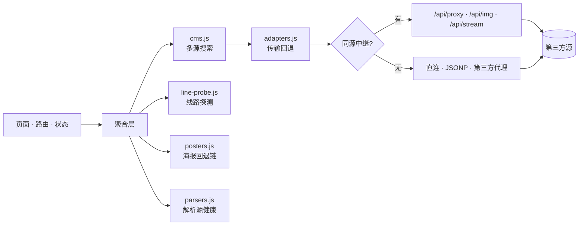

### 一次搜索的流程

1. **选源** —— 只取已启用且可搜索的源，按健康分排序。
2. **并发池** —— 4 个 worker 从队列取源，每返回一个就触发增量渲染。
3. **传输** —— 先试上次成功的方法；失败后沿回退阶梯下降。
4. **解析** —— JSON/XML 自动识别，统一成剧集结构。
5. **合并** —— 归一化标题建索引，重复项合并，记录来源数。
6. **过滤与缓存** —— 低相关结果丢弃；命中与快速线路缓存 30 分钟。

### 海报回退链

1. **原图** —— 源站自己的海报。
2. **跨源池** —— 豆瓣 `subject_suggest` → Bangumi → wmdb，按片名与年份匹配。
3. **CDN 镜像** —— 豆瓣图床拒绝外链时走同源 `/api/img`。

命中缓存 12 小时，未命中 1 小时；全部失败时显示渐变占位图，页面不会卡在海报上。

### 解析源巡游

解析面板不会“第一个源失败就罢工”：

1. 构建期生成 `public/jx-health.json`（`npm run health`），记录每个解析源最近一次状态。
2. 客户端按状态、目标页记忆、速度排序。
3. 先加载最佳直连候选；超时或报错后自动巡游下一路。
4. 页面已加载但显示解析失败时，可手动点“下一路”。
5. 全部失败时给出“新窗口打开 / 换目标 / 换源”，而不是死路。

## 快速开始

**要求：** Node.js ≥ 18，现代浏览器。

```bash
git clone https://github.com/creatememori/zhiyinglu-tv.git
cd zhiyinglu-tv
pnpm install        # 或 npm install
pnpm run dev        # http://localhost:5173
```

```bash
pnpm run build      # 构建到 dist/
pnpm run preview    # 预览构建
pnpm test           # Node 原生测试（15 个文件，86 项）
pnpm run health     # 可选：刷新解析源健康清单
```

说明：

- 开发模式下 `vite.config.js` 会把 `worker/proxy-core.js` 挂成中间件，`/api/*` 本地可用。
- Service Worker 只在生产构建注册，不会干扰 HMR。
- `node dev-server.mjs` 在 8787 端口同时提供静态文件与 API；`start.sh` 是 VPS 快捷脚本。

## 部署

| 平台 | 入口 | 说明 |
|---|---|---|
| **Vercel** | `api/` | 自动识别为 Serverless Function；海外出口可能被大陆源拦截 |
| **Cloudflare Pages** | `functions/` | 自动识别；也可用 `wrangler.toml` 直接部署 `worker/` |
| **VPS / 独立服务器** | `node dev-server.mjs` | 8787 端口，静态 + API 一体，最适合大陆源 |
| **任意静态托管** | `dist/` | 没有中继也能跑，只是少一些跨域兜底 |

部署注意：

1. 构建产物是纯静态文件。
2. 中继必须和站点同源，或在设置里指定 `relayBase`。
3. 新增源域名要加进 `worker/proxy-core.js` 的 allowlist。
4. `api/proxy.js` 与 Worker 共用白名单，改一边要同步另一边。

## 项目结构

```text
.
├── api/                 # Vercel Serverless：proxy / img / stream / health
├── functions/           # Cloudflare Pages Functions：薄封装
├── worker/              # Cloudflare Worker；proxy-core.js 是中继唯一实现
├── src/
│   ├── api/             # 聚合：cms / adapters / line-probe / posters / parsers / resolver
│   ├── core/            # 状态、路由、IndexedDB、配置迁移、工具
│   ├── pages/           # home / search / category / detail / play / history / sources / settings / live
│   ├── player/          # ArtPlayer 封装 + 自定义进度条
│   ├── ui/              # Toast / Modal / 海报卡片 / SVG 图标
│   ├── effects/         # cinema、liquid-dock、feedback、interactions、wireframe
│   └── styles/          # app.css + cinema.css + feedback.css
├── public/              # logo、manifest、Service Worker、解析源健康清单
├── scripts/             # jx-health.mjs（构建期解析源探测）
├── tests/               # 15 个 Node 原生测试文件
├── docs/                # 截图、设计说明、中继契约
├── dev-server.mjs       # VPS 一体服务器（静态 + API）
├── vite.config.js       # 相对 base、播放器分包、本地中继插件
└── vercel.json / wrangler.toml / start.sh
```

## 技术栈

| 类别 | 技术 | 说明 |
|---|---|---|
| 框架 | **原生 ES Modules** | 无 React / Vue / jQuery；每个路由挂载自己的页面 |
| 构建 | Vite 6 | 相对 `base`，可部署在任意子路径 |
| 播放器 | ArtPlayer 5 · hls.js | 单独分包，只在播放页加载 |
| 玻璃 | `@colineapp/liquid-glass` 0.3 | 官方 tab 轨道与折射 thumb |
| 存储 | IndexedDB | 进度、历史、收藏、配置、海报缓存 |
| PWA | Service Worker · Web Manifest | 离线壳 + stale-while-revalidate |
| 中继 | Workers · Pages Functions · Vercel | 一份 `proxy-core.js`，三种宿主 |
| 测试 | Node.js 原生 test runner | 不需要 Jest / Vitest |

三个运行时依赖：`artplayer`、`hls.js`、`@colineapp/liquid-glass`。其余全部手写。

## 浏览器支持

| 浏览器 | 支持 | 说明 |
|---|---|---|
| Chrome / Edge 90+ | ✅ | 完整体验，可安装 PWA |
| Safari 15+（含 iOS） | ✅ | 分享 → 添加到主屏幕，获得独立窗口 |
| Firefox 90+ | ✅ | 无 PWA 安装入口，其余功能正常 |
| 旧浏览器 | ⚠️ | 需要 ES Modules、IndexedDB、Service Worker；不支持 IE |

> 液态玻璃 Dock 使用 SVG 折射。Chromium 有真实边缘位移；Safari / Firefox 回退为磨砂玻璃 + 边缘高光。低内存设备与“减少动态”模式也会自动降级。

## 常见问题

<details>
<summary><b>为什么某个源搜不到，或者搜到却播不了？</b></summary>

通常是三种原因：源站挂了、屏蔽海外 IP、校验 Referer。先到 **数据源 → 体检** 跑一遍；失败源会被暂停两小时。如果搜索正常但播放失败，多半是线路本身已死，换一条线路或换一个源即可。
</details>

<details>
<summary><b>部署到 Vercel 后大部分源都失效，是 bug 吗？</b></summary>

不是。Vercel 从海外出口访问，很多大陆媒体 API 会拒绝或返回空。想要稳定，部署到大陆 VPS 并运行 `node dev-server.mjs`，或在设置里把 `relayBase` 指向自己的中继。
</details>

<details>
<summary><b>真的是纯前端吗？</b></summary>

应用逻辑完全在浏览器：搜索、解析、去重、播放、存储都不经过服务器。中继只负责替浏览器发请求，绕开 CORS；没有中继时会回退到直连 / JSONP，功能仍在，只是可用的源少一些。
</details>

<details>
<summary><b>我的数据存在哪？</b></summary>

IndexedDB：进度、历史、收藏、配置、海报缓存。清除站点数据就会丢失；换设备前到 **设置 → 数据迁移** 导出 JSON。
</details>

<details>
<summary><b>更新后还是旧界面？</b></summary>

Service Worker 缓存了应用壳。强制刷新（Ctrl/Cmd + Shift + R）或关闭全部标签页再打开。每次发版会更新 `public/sw.js` 里的 `VERSION`，自动清旧缓存。
</details>

<details>
<summary><b>怎么添加自己的源？</b></summary>

**设置 → 数据源 → 添加**，填名称和 API URL，`format` 先留 `auto`（自动识别 JSON/XML）。非标准结构且能直连时用 `custom`。跑一次体检，再启用。批量修改用 **数据迁移** 导入 JSON。
</details>

<details>
<summary><b>为什么内置源有那么多是关闭的？</b></summary>

35 个里有 21 个默认启用。其余是导航站、需要授权，或只返回列表没有可播线路。关掉它们可以让体检和搜索更快。
</details>

## 隐私与免责声明

- **不存储、不上传任何视频内容。** 只聚合第三方公开 API 返回的元数据与播放地址。
- 播放地址来自第三方站点，其可用性与合法性由对方负责。本项目不托管、不转码、不缓存视频流（`/api/stream` 仅透传）。
- 所有个人数据都留在浏览器里，作者无法访问。
- 数据源收集自公开网络。若你是权利人并认为某个源侵权，请直接联系该源；收到通知后会移除默认条目。
- 仅供学习与技术研究，请遵守所在地区法律。

## 支持项目

- ⭐ 点一个 Star，就是最简单的鼓励。
- ☕ [请作者喝杯咖啡](https://ko-fi.com/creatememori)
- 💜 [爱发电](https://ifdian.net/a/creatememori)
- 💬 QQ 群：[661816585](https://qm.qq.com/q/tKu1lR8oPm)，反馈 bug 与失效源。

[](https://star-history.com/#creatememori/zhiyinglu-tv&Date)

## 许可证

[MIT](./LICENSE) © 2026 creatememori

---

<div align="center">

<a href="https://ko-fi.com/creatememori"></a>

<sub>💬 QQ 群 661816585 · 本项目不托管任何视频内容，仅聚合第三方公开 API。</sub>

</div>