<div align="center">

<a href="https://ko-fi.com/creatememori">
  
</a>

# 知影录 • Tv

> 🎬 纯前端影视聚合 SPA —— 多源并行搜索，命中即播

[](https://github.com/creatememori/zhiyinglu-tv/stargazers)
[](https://github.com/creatememori/zhiyinglu-tv/network/members)
[](https://github.com/creatememori/zhiyinglu-tv/issues)
[](./LICENSE)


[](https://ko-fi.com/creatememori)
[](https://qm.qq.com/q/tKu1lR8oPm)
[](https://ifdian.net/a/creatememori)


🖥️ **在线预览** → [tv-eosin-five.vercel.app](https://tv-eosin-five.vercel.app/)

<sub>⚠️ 预览站部署在 Vercel（海外节点），部分国内接口源会被限流或屏蔽，封面与列表可能加载不全；完整体验请按下方步骤自部署。</sub>

[](https://vercel.com/new/clone?repository-url=https://github.com/creatememori/zhiyinglu-tv)
[](https://dash.cloudflare.com/)

</div>

---

📖 **Readme:** [English](README.md) | **简体中文**

> [!TIP]
> **一句话**：把「十几个影视站的搜索框」合并成一个，在你自己的浏览器里跑。
> 没有账号、没有数据库、没有后端服务；源挂了会自己降级，线路慢的会被自动排到后面，数据只存在你的 IndexedDB 里。

> [!NOTE]
> 内置 **35 个影视源接口**（默认启用 21 个）· **8 个目录参考** · **9 个点播解析源**，开箱即用，也可以在设置里全部换成你自己的。

## 目录

- [它解决什么问题](#它解决什么问题)
- [60 秒跑起来](#60-秒跑起来)
- [界面预览](#界面预览)
- [功能](#功能)
- [它是怎么工作的](#它是怎么工作的)
- [数据源说明](#数据源说明)
- [快速开始](#快速开始)
- [部署](#部署)
- [项目结构](#项目结构)
- [技术栈](#技术栈)
- [浏览器支持](#浏览器支持)
- [常见问题](#常见问题)
- [隐私与免责](#隐私与免责)
- [支持这个项目](#支持这个项目)
- [License](#license)

## 它解决什么问题

找一部片，通常要在三五个站点之间来回试：这个站搜不到、那个站的线路卡、换个站又要重新记进度。知影录把这件事收进一个页面里，并且尽量不让「源的质量」影响你的体验。

| 常见的影视聚合站 | 知影录 |
|---|---|
| 依赖后端、数据库、采集脚本 | **纯前端**，浏览器就是运行时；数据存本地 IndexedDB |
| 一个源挂了，整页空白或转圈 | 每个源独立健康分，连续失败自动熔断 2 小时，一键体检可换源 |
| 搜索要等所有源都返回才出结果 | 4 路并发，**先到先显**，越搜越多 |
| 点进播放页才知道哪条线路快 | 详情页静默预检线路，进播放页直接排好序 |
| 想部署得先买服务器 | Vercel / Cloudflare Pages / 任意 VPS 都能跑；中继是**可选**的 |

## 60 秒跑起来

```bash
git clone https://github.com/creatememori/zhiyinglu-tv.git
cd zhiyinglu-tv
npm install
npm run dev        # → http://localhost:5173
```

打开首页，随便搜一部片，点封面就能看到线路。第一次使用会有一个简短的功能引导。

不想本地跑？直接开[在线预览](https://tv-eosin-five.vercel.app/)，代价是部分国内源在海外节点上不可达。

## 界面预览

| 首页 · 首屏 | 首页 · 榜单 |
|---|---|
| 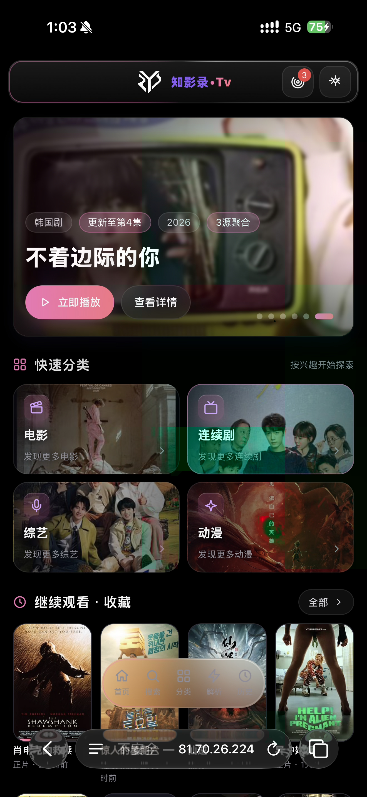 | 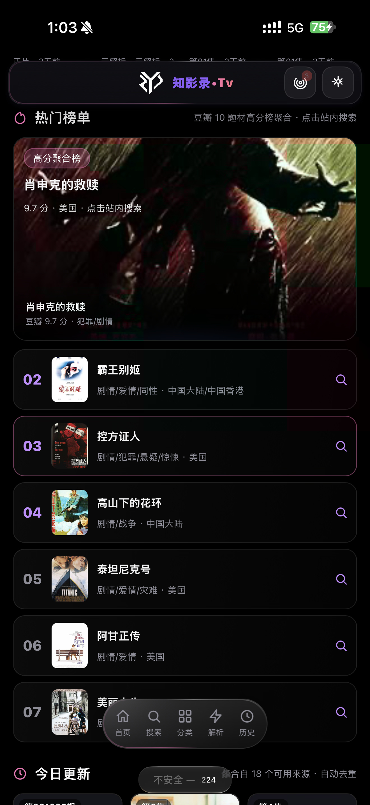 |
| 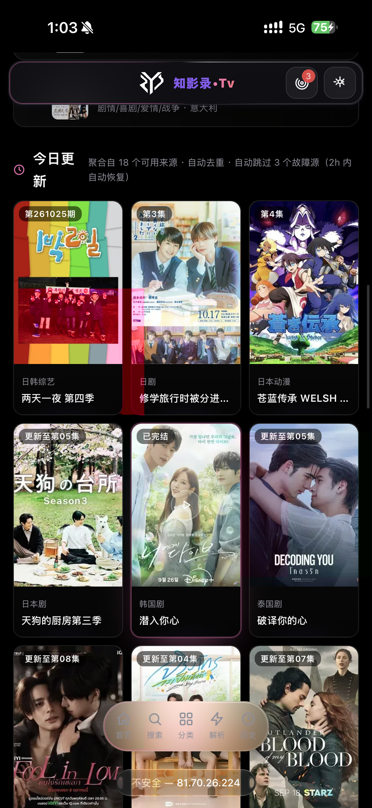 | 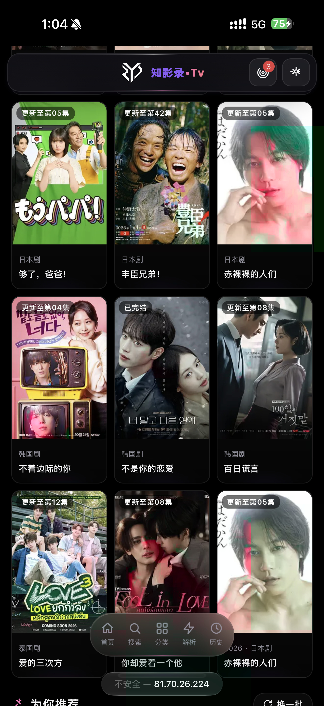 |

<details><summary><b>📱 展开其余 11 张截图</b></summary>

| 首页 · 移动端 | 首页 · 移动端 |
|---|---|
| 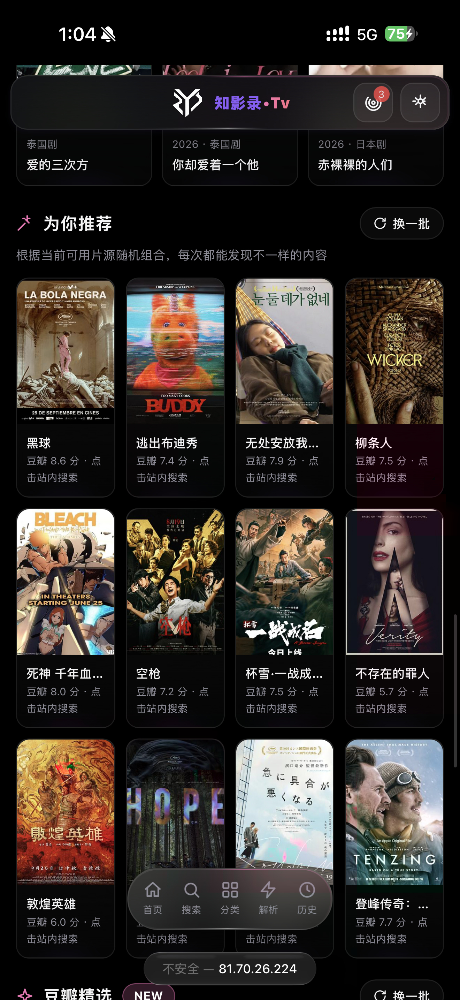 | 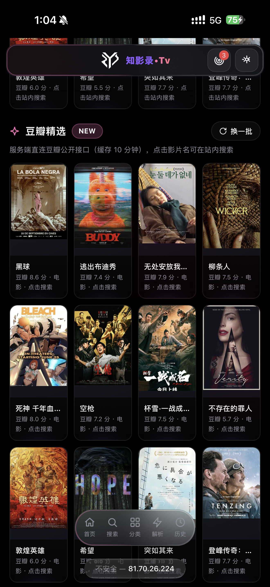 |

| 🔍 搜索 | 📂 分类 |
|---|---|
| 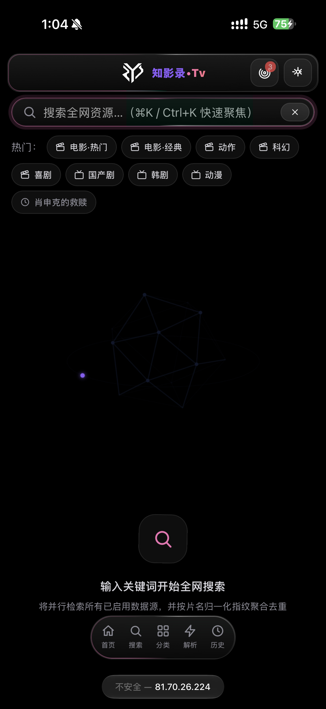 | 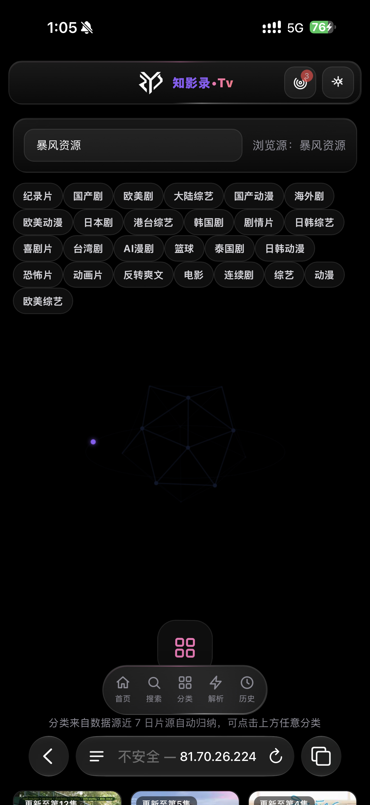 |

| 📂 分类 · 筛选 | ⚡ 在线解析 |
|---|---|
| 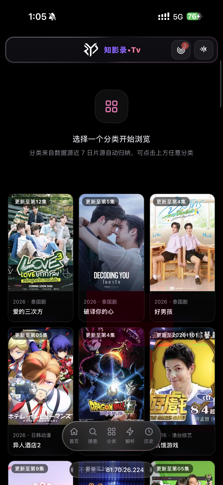 | 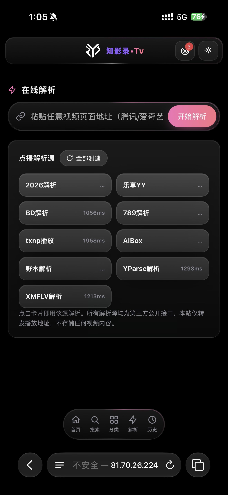 |

| 📖 观看历史 | 📡 数据源管理 |
|---|---|
| 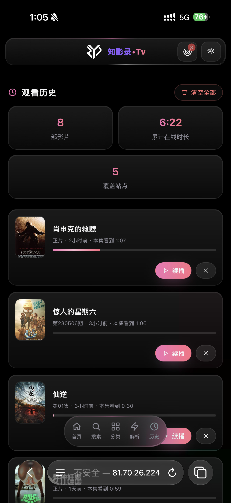 | 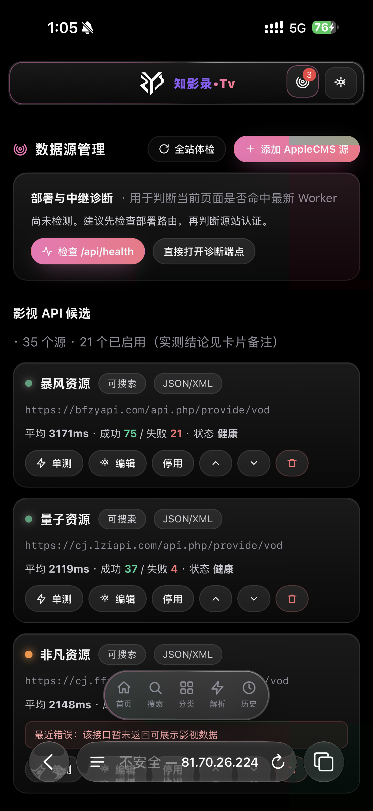 |

| 🎨 UI 自定义 | ⚙️ 设置 |
|---|---|
| 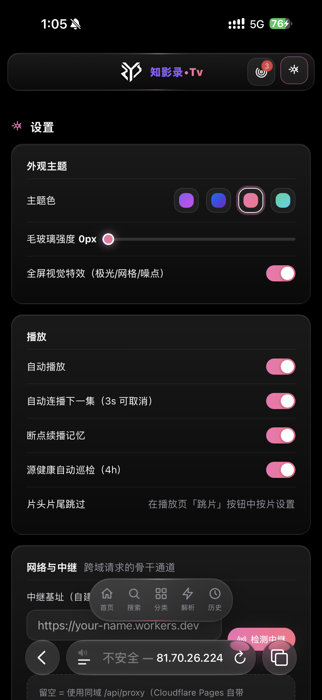 | 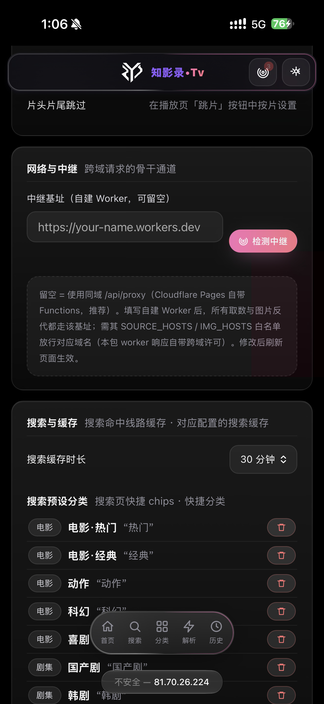 |

| ⚙️ 设置 · 数据迁移 | |
|---|---|
| 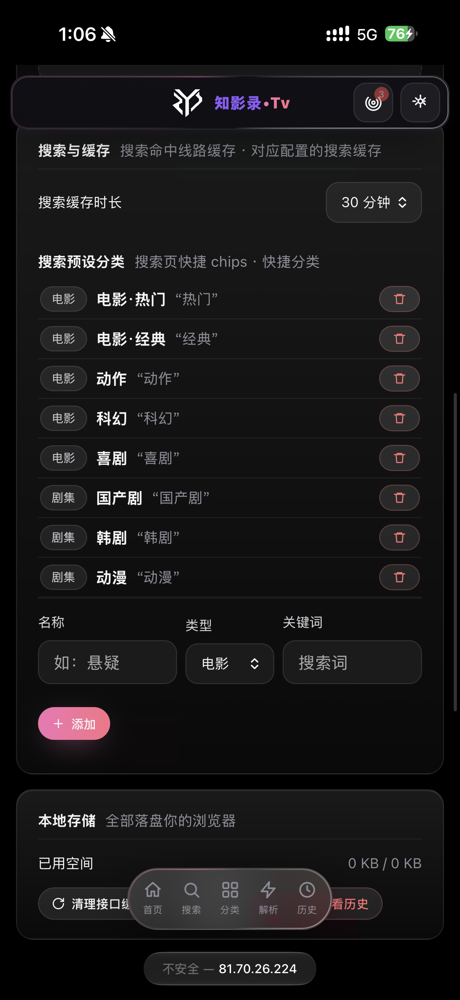 | |

</details>

## 功能

### 🏠 首页聚合

- **Hero 轮播** — 热门影片大图，点击直达播放页
- **四大分区** — 电影 / 连续剧 / 综艺 / 动漫，一键进入分类
- **热门榜单** — 豆瓣高分与多题材聚合排行，点条目直接转站内搜索
- **今日更新** — 启用中的源实时聚合、按片名指纹去重
- **为你推荐** — 豆瓣精选 + 源站随机，每次刷新都有新东西

### 🔍 全源并行搜索

- **4 路并发** — 同时向最多 4 个源发起请求，返回一个渲染一个
- **指纹去重** — 片名归一化（全半角、季数后缀、标点、繁简）后合并，标注「双源 / 3 源」
- **双协议解析** — JSON / XML 自动识别，字段别名统一成内部结构
- **相关性过滤** — 片名相似度 + 年份 + 关键词命中，过滤掉源站的「沾边结果」
- **预设分类** — 电影 / 剧集 / 动漫 / 综艺，一键切换搜索范围

### 🎬 详情与线路

- **详情页静默预检** — 进入详情页后台并行探测每条直链的首包，6 并发、单条约 171–300ms
- **线路排序** — 源健康分 × 0.4 + 预检速度 × 0.4 + 直链优先 × 0.2，可播的排前面
- **同 CDN 跳过** — 同一个 hostname 视为同一故障域，一条挂了不再浪费一次尝试
- **失败记忆** — 同一线路失败会被减分，下回自动沉底

### ▶️ 播放体验

- **ArtPlayer 5 + hls.js** — m3u8 / mp4 / flv 全格式，播放器按需加载（首包不带 ~400KB 播放器代码）
- **片头片尾跳过** — 按片名独立记忆 intro / outro 秒数
- **断点续播** — 进度写 IndexedDB，刷新、关机、换设备导入配置都不丢
- **自动连播** — 一集结束 3 秒倒计时跳下一集
- **云解析** — 粘贴 VIP 平台页面地址，自动走点播解析源
- **直播** — 导入 M3U 直播源后进入电视直播页，直播流独立配置（无进度条 / 无倍速 / 不写历史）

### 📡 数据源与中继

- **35 个内置影视源**（默认启用 21 个）+ **8 个目录参考** + **9 个点播解析源**
- **一键体检** — 3 并发探测延迟与可用性，给出健康分并自动停用失效源
- **自动熔断** — 连续失败的源暂停 2 小时，成功后自动恢复
- **自定义源** — 手动添加接口（`auto` / `xml` / `custom` 三种格式）+ JSON 配置导入导出
- **同域中继** — `/api/proxy`、`/api/img`、`/api/stream`，白名单域名才转发，图片带 Referer 绕过防盗链

### 📱 PWA 与视觉

- **离线应用壳** — Service Worker 缓存静态资源，断网也能打开；导航网络优先、静态资源 SWR
- **可安装** — 手机添加到主屏，接近原生体验
- **液态毛玻璃** — 自研 CSS 设计系统（约 78KB），4 套主题色（aurora / vercel / sunset / mint）
- **可调强度** — 毛玻璃强度 0–40 实时调节
- **细节动效** — 光标光晕、3D 线框、卡片倾斜、滚动渐入，全部 `prefers-reduced-motion` 友好

## 它是怎么工作的

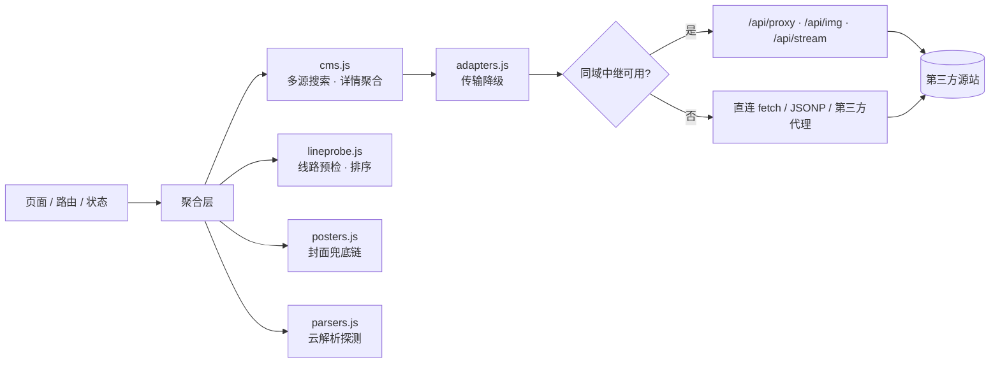

### 搜索一次，发生了什么

1. **选源** — 只取 `enabled && searchable` 的源，按健康分从高到低排序
2. **起池** — 4 个并发 worker 从队列里领任务，**谁先返回先渲染谁**（`onSourceResult` 增量回调）
3. **传输** — 每个源按上次成功的方式优先；失败则依次降级（见下表）
4. **解析** — 自动识别 JSON / XML，把 `vod_play_url` 这类字段归一成 `[{name, eps:[{label,url}]}]`
5. **去重** — 片名归一化后建索引，合并同一部片的多源结果，保留信息最全的那条，打上「N 源」标记
6. **过滤** — 相关性不足的结果丢弃，避免「搜《沙丘》出来《沙丘之子》」
7. **缓存** — 命中的结果与快速线路缓存 30 分钟（最多 60 条），二次搜索直接秒出

### 传输降级阶梯

一个源在这次请求里会按顺序尝试，任何一步成功就记下来，下次优先用它。

| 顺序 | 方式 | 适用 |
|---|---|---|
| 1 | 记住的上次成功方式 | 同一源、同一接口类型 |
| 2 | 同域中继 `/api/proxy` | 部署在 Vercel / CF Pages / 自建 Worker 时 |
| 3 | 直连 `fetch` | 源站允许 CORS |
| 4 | JSONP | 不支持 CORS 的老式 AppleCMS 接口 |
| 5 | 第三方代理 | 设置页里填的代理前缀，逐个尝试 |

中继与直连之间还有一层**竞速**：中继拿到 800ms 仍无结果时，直连请求抢跑，谁先成功用谁——避免「中继慢半拍，整页傻等」。

### 封面兜底链

封面是最容易「404 / 防盗链 / 跨域」的一环，所以做了三级：

1. **原图** — 源站海报直接能出就出
2. **跨源海报池** — 豆瓣 `subject_suggest` → Bangumi → wmdb，标题 + 年份双条件校验，防同名错配
3. **CDN 镜像** — 豆瓣图床会校验 Referer（直接引用 418），走 `/api/img` 同域转存；bgm / wmdb 直连失败再降级

命中缓存 12 小时，查不到也记 1 小时（负缓存），避免反复打空。全链失败时用渐变占位，不阻塞页面。

### 线路预检

- 只取 **Range 首 1KB**，不下载整片，单条约 171–300ms
- **6 并发池**：15 条线路约 2–3 秒测完，藏在用户浏览详情页的时间里
- 结果写会话缓存 **5 分钟**，详情页 → 播放页直接复用
- 返回 `text/html` 的视为「页面不是流」，直接判不可播

### 中继（可选）

```
浏览器 ──▶ /api/proxy?url=<源站>  ──▶ 白名单校验 ──▶ 源站
         /api/img?url=<图片>      ──▶ Referer 伪装 + 1 天缓存
         /api/stream?url=<分片>   ──▶ 原样透传（m3u8 分片）
```

- 只在**同域**或**设置里填的中继基址**上探测一次 `/api/health`，探测结果会话内缓存
- 中继存在时默认走中继（绕 CORS），但**中继不可用不影响使用**——自动降级直连
- 白名单写在 `worker/proxy-core.js`，`api/` 与 `functions/` 共用同一份逻辑

## 数据源说明

| 类型 | 数量 | 作用 | 在哪改 |
|---|---|---|---|
| 影视源（CMS） | 35（默认启用 21） | 搜索、详情、播放线路 | 数据源 → 影视源 |
| 目录参考 | 8 | 分类目录、片单索引，不做播放 | 数据源 → 目录 |
| 点播解析 | 9 | VIP 页面地址转可播地址 | 数据源 → 解析 |

默认启用的 21 个是实测能取到数据的接口；其余 14 个属于目录站、需要授权或半可用，默认关闭，避免拖慢体检与搜索。

**加一个自己的源**（设置 → 数据源 → 添加）：

```json
{
  "id": "my-cms",
  "name": "我的源",
  "api": "https://example.com/api.php/provide/vod",
  "format": "auto",
  "enabled": true,
  "searchable": true,
  "timeout": 9000
}
```

`format` 取值：`auto`（JSON/XML 自动识别）、`xml`（固定 maccms XML）、`custom`（非标准结构，需要源站能直连）。

**导入 / 导出**：设置 → 数据迁移，导出的是完整配置（源、解析、代理、预设、播放偏好），换设备直接导入。导入会做严格校验：URL 必须 http(s)、ID 去重、数量上限（代理 20 / 预设 30 / 直播源 200 / 收藏 1000）。

## 快速开始

**要求**：Node.js ≥ 18（Vite 6 的最低要求），现代浏览器。

```bash
npm install
npm run dev      # 开发服务器 http://localhost:5173，自动挂载本地中继
npm run build    # 产物到 dist/，纯静态
npm run preview  # 预览构建结果
npm test         # Node 原生测试运行器，14 个测试文件
```

说明：

- 开发模式下 `vite.config.js` 会把 `worker/proxy-core.js` 挂成中间件，所以本地也能用 `/api/*` 中继
- Service Worker **只在生产构建注册**，开发时不会被缓存干扰
- `start.sh` 是给 VPS 一键起 `dev-server.mjs` 用的（端口 8787），不是必须

## 部署

| 平台 | 入口 | 说明 |
|---|---|---|
| **Vercel** | `api/` | 自动识别 Serverless Function；海外 IP 可能被部分国内源限制 |
| **Cloudflare Pages** | `functions/` | 自动接管中继；也可单独部署 `worker/`（`wrangler.toml` 已配好） |
| **VPS / 裸机** | `node dev-server.mjs` | 端口 8787，静态文件 + API 一体，国内源最稳 |

部署要点：

1. 产物是纯静态，任何静态托管都能跑；**没有中继也能用**，只是少一层 CORS 兜底
2. 想用中继就必须让站点与 `/api/*` 同域（或设置页填 `relayBase`）
3. 源站域名要在 `worker/proxy-core.js` 的白名单里，否则 403——加源时顺手加域名
4. Vercel 上的 `api/proxy.js` 与 Worker 共用白名单，改动记得两边同步

## 项目结构

```text
.
├── api/                 # Vercel Serverless：proxy / img / stream / health
├── functions/           # Cloudflare Pages Functions：同上的薄封装
├── worker/              # Cloudflare Worker：proxy-core.js 是唯一实现
├── src/
│   ├── api/             # 聚合引擎：cms / adapters / lineprobe / posters / parsers
│   ├── core/            # 状态、路由、IndexedDB、配置迁移、工具函数
│   ├── pages/           # 首页 / 搜索 / 分类 / 详情 / 播放 / 历史 / 数据源 / 设置 / 直播
│   ├── player/          # ArtPlayer 封装 + 自定义进度条
│   ├── ui/              # Toast / Modal / 海报卡片 / SVG 图标集
│   ├── effects/         # 光标光晕 / 3D 线框 / 卡片倾斜 / 滚动渐入
│   └── styles/          # 液态毛玻璃设计系统
├── public/              # logo、manifest、Service Worker
├── tests/               # 14 个 Node 原生测试文件
├── docs/screenshots/    # README 截图
├── dev-server.mjs       # VPS 一体服务器（静态 + API）
├── vite.config.js       # 相对 base、播放器独立 chunk、本地中继插件
└── vercel.json / wrangler.toml / start.sh
```

## 技术栈

| 类别 | 技术 | 说明 |
|---|---|---|
| 框架 | **原生 ES Module** | 不用 React / Vue / jQuery，页面按路由懒挂载 |
| 构建 | Vite 6 | `base: './'`，任何子路径都能部署 |
| 播放器 | ArtPlayer 5 · hls.js | 独立 chunk，进播放页才加载 |
| 存储 | IndexedDB | 进度、历史、收藏、配置、海报缓存 |
| PWA | Service Worker · Web Manifest | 应用壳离线 + 静态资源 SWR |
| 中继 | Workers / Pages Functions / Vercel | 同一份 `proxy-core.js` 三种宿主 |
| 测试 | Node.js 原生 test runner | 无需 Jest / Vitest |

运行时依赖只有两个库：`artplayer` 与 `hls.js`——其余全是自己写的。

## 浏览器支持

| 浏览器 | 支持 | 备注 |
|---|---|---|
| Chrome / Edge 90+ | ✅ | 完整体验，含 PWA 安装 |
| Safari 15+（含 iOS） | ✅ | 需「分享 → 添加到主屏幕」才有独立窗口 |
| Firefox 90+ | ✅ | 无 PWA 安装入口，其余正常 |
| 老旧浏览器 | ⚠️ | 依赖 ES Module / IndexedDB / Service Worker，IE 不支持 |

移动端建议加到主屏使用：地址栏收起后是纯全屏，观感接近原生 App。

## 常见问题

<details>
<summary><b>为什么有些源搜不到东西，或者播放失败？</b></summary>

三种常见原因：源站自己挂了、源站限制了海外 IP、源站校验 Referer。

先点「数据源 → 一键体检」，连续失败的源会被自动停用 2 小时；如果只有播放失败但搜索正常，多半是线路本身失效，换一条线路或换一个源即可。部署在海外节点时，国内源失败率会明显更高。
</details>

<details>
<summary><b>部署到 Vercel 后大片源不可用，是不是代码有问题？</b></summary>

不是。Vercel 是海外出口，很多国内影视接口对海外 IP 直接拒绝或返回空。想要稳定，把同一个仓库部署到国内 VPS（`node dev-server.mjs`），或者在设置里把 `relayBase` 指向你自己的中继。
</details>

<details>
<summary><b>真的不需要后端吗？中继是干什么的？</b></summary>

运行逻辑 100% 在浏览器里：搜索、解析、去重、播放、存储都不经过服务器。中继只做一件事——替你向源站发请求，绕开浏览器的 CORS 限制。没有中继时应用会降级为直连 / JSONP，功能不残缺，只是能连上的源会少一些。
</details>

<details>
<summary><b>我的数据存在哪里？换设备会丢吗？</b></summary>

全部在浏览器的 IndexedDB 里（进度、历史、收藏、配置、海报缓存）。清理站点数据会丢；换设备请先在「设置 → 数据迁移」导出 JSON，再到新设备导入。
</details>

<details>
<summary><b>PWA 怎么安装？</b></summary>

- Android / 桌面 Chrome / Edge：地址栏右侧出现「安装」图标，点击即可
- iOS Safari：分享按钮 → 「添加到主屏幕」
- 安装后从桌面图标启动，没有浏览器地址栏；离线时能打开应用壳（内容仍需联网）
</details>

<details>
<summary><b>更新之后还是旧界面？</b></summary>

Service Worker 会缓存应用壳。强刷一次（Ctrl/Cmd + Shift + R）或关掉所有标签页重开即可；新版本发布时 `sw.js` 里的 `VERSION` 会变，旧缓存自动清理。
</details>

<details>
<summary><b>怎么加自己的源？格式怎么写？</b></summary>

设置 → 数据源 → 添加，填名称和 API 地址，`format` 选 `auto` 即可（会自动识别 JSON / XML）。非标准接口选 `custom`，需要源站允许直连。加完点「体检」确认能通，再设为启用。批量迁移用「数据迁移」导入 JSON。

如果部署了自己的中继，记得把新源站域名加进 `worker/proxy-core.js` 的白名单。
</details>

<details>
<summary><b>封面加载慢或者空白？</b></summary>

封面走三级兜底（原图 → 豆瓣/Bangumi/wmdb → CDN 镜像），豆瓣图床会因为 Referer 返回 418，所以需要 `/api/img` 中继。没有中继时部分封面会失败，此时显示渐变占位而不是裂图。命中过的封面会缓存 12 小时。
</details>

<details>
<summary><b>支持投屏、下载、倍速吗？</b></summary>

- 倍速：支持（播放器内置）
- 投屏：不支持，浏览器端没有稳定的通用协议；可用系统级投屏
- 下载：不支持，也不计划做——只做在线播放，不落地视频文件
</details>

<details>
<summary><b>为什么默认有一半源是关闭的？</b></summary>

35 个里默认启用 21 个，其余 14 个是目录站、需要授权、或只能取列表不能取播放地址的「半可用」源。默认关掉可以避免体检和搜索被拖慢；需要时在数据源页手动打开即可。
</details>

## 隐私与免责

- **不存储、不上传任何视频内容**，只聚合第三方公开接口返回的元数据与播放地址
- 播放地址来自第三方站点，可用性与合法性由源站负责；本项目不托管、不转码、不缓存视频流（`/api/stream` 仅透传分片）
- 所有个人数据（进度、历史、收藏、配置）只存在你的浏览器本地，仓库作者无法访问
- 接口源来自公开网络，若你是权利人并认为某个源侵权，请直接联系源站；本项目会在收到通知后移除对应默认源
- 仅供学习与技术研究，请遵守所在地区法律法规

## 支持这个项目

如果它帮你省下了在几个站点之间来回找片的时间：

- ⭐ 点个 **Star**，是最直接的鼓励
- ☕ [请作者喝杯咖啡](https://ko-fi.com/creatememori)
- 💜 [爱发电](https://ifdian.net/a/creatememori)
- 💬 QQ 群：[661816585](https://qm.qq.com/q/tKu1lR8oPm)（问题反馈、源失效同步）

[](https://star-history.com/#creatememori/zhiyinglu-tv&Date)

## License

[MIT](./LICENSE) © 2026 creatememori

---

<div align="center">

<a href="https://ko-fi.com/creatememori"></a>

<sub>💬 QQ群：661816585 · 本应用不存储、不上传任何视频内容，仅聚合第三方公开接口</sub>

</div>